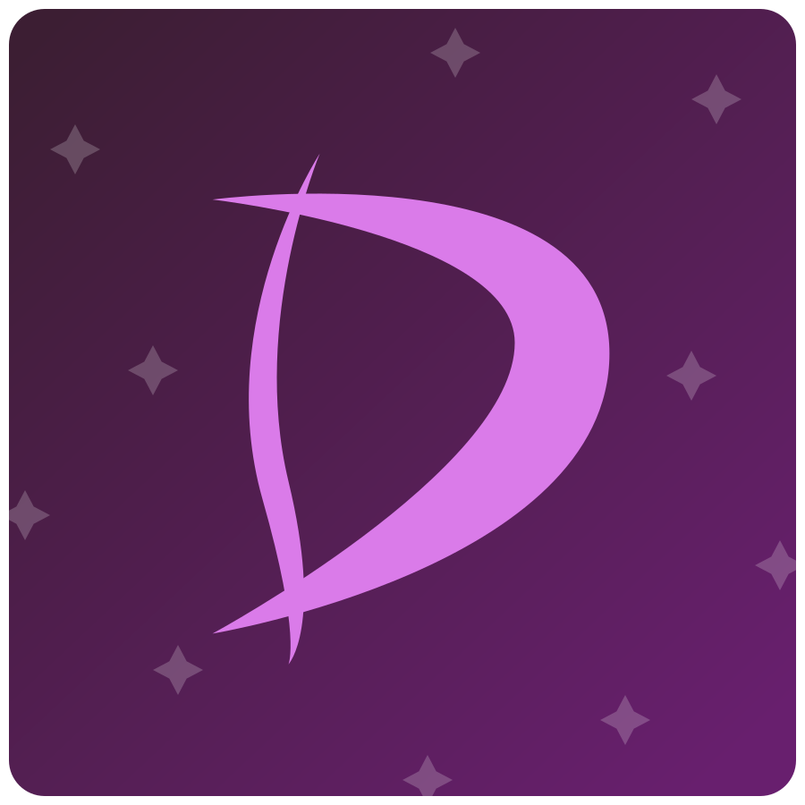

<p align="center">
  
</p>

# DiscendoLMS SDK | A framework-agnostic SDK for any Learning Management System (LMS)

> **Pre-1.0.** The API can still change between minor versions; every change that touches your code is listed in the [migration guide](./docs/MIGRATION.md) and the [changelog](./CHANGELOG.md).

A framework- and database-agnostic TypeScript SDK of LMS (Learning Management System) logic. It has no runtime dependencies and runs on Node 20+, Bun, Deno, browsers and edge runtimes. The SDK provides typed domain models, pure calculation functions, and repository-interface-driven services for the core concerns of a learning platform — from a single-tutor setup to a multi-department university.

It never assumes a specific database, ORM, web framework, or UI: every module exposes interfaces the host application implements against whatever stack it already uses.

This SDK aims to standardize the core LMS logic so that different host applications can share the same domain model and business rules, while still being free to implement their own persistence, UI, and integrations. Just slap the SDK into your project, implement the repository interfaces, and you have a fully-featured LMS backend ready to go.

## Install

```sh
npm install discendo-sdk      # or: bun add discendo-sdk / pnpm add discendo-sdk
```

## Try it in a minute

`createInMemoryLms()` wires every service to in-memory storage, with permission checks on, so you
can try the SDK before writing any database code:

```ts
import { createInMemoryLms } from 'discendo-sdk/testing';

const lms = createInMemoryLms();
const as = (actorId: string) => ({ actorId });

lms.repos.users.seed({ id: 'admin', roles: ['admin'] }, { id: 'ms-lee', roles: ['instructor'] }, { id: 'sam', roles: ['student'] });
lms.repos.courses.seedCourse({ id: 'bio', title: 'Biology' }).seedSection({ id: 'bio-a', courseId: 'bio', status: 'published' });

const { enrollment, content, assessment, grading } = lms.services;
await enrollment.enroll({ userId: 'ms-lee', sectionId: 'bio-a', role: 'instructor' }, as('admin'));
await enrollment.enroll({ userId: 'sam', sectionId: 'bio-a', role: 'student' }, as('admin'));

const essay = await content.createNode({ sectionId: 'bio-a', kind: 'assignment', title: 'Cells', orderIndex: 0, published: true }, as('ms-lee'));
const sub = await assessment.submit(essay.id, 'sam', { kind: 'text', content: 'Cells are...' }, undefined, as('sam'));
await grading.recordGrade(sub.id, 'sam', 18, 20, 'ms-lee', undefined, as('ms-lee'));

await grading.computeFinalGradeForUser('sam', 'bio-a', { categories: [{ name: 'assignment', weight: 1 }] }, as('sam')); // 90
```

When you are ready for a real database, implement the repository interfaces for your stack and
check them with the contract suites in `discendo-sdk/testing` (see [TESTING.md](./docs/TESTING.md)).
Every service is built the same way: `new XService({ repos, policy, events })`.

## Documentation

The documentation site is at **https://thecodeheist.github.io/discendo-lms-sdk/**.

Start at the [documentation index](./docs/INDEX.md). Every module has its own page
with its types, methods, permissions, events, known limitations and tests, and there are
dedicated pages for [permissions](./docs/PERMISSIONS.md), [tenancy](./docs/TENANCY.md),
[events](./docs/EVENTS.md) and [guardians](./docs/GUARDIANS.md). New to the SDK? Begin
with [Getting Started](./docs/GETTING_STARTED.md).

## Project layout (for contributors and plugin authors)

Source is organized into layers, each with its own `README.md` explaining
what belongs there:

| Layer                                       | What goes here                                                                                      | Start with                                                   |
| ------------------------------------------- | --------------------------------------------------------------------------------------------------- | ------------------------------------------------------------ |
| [`src/core/`](./src/core/README.md)         | Shared types, repository interfaces, the `EventBus`, tenancy and permissions                        | `events.ts`                                                  |
| [`src/domains/`](./src/domains/README.md)   | Modules that own a primary entity: enrollment, content, assessment, grading, delegation, scheduling | [`scheduling/README.md`](./src/domains/scheduling/README.md) |
| [`src/services/`](./src/services/README.md) | Cross-cutting modules that consume what domains produce: communication, reporting, admin            | —                                                            |
| `src/interop/`                              | Pluggable protocol seams (LTI, SSO, SCORM/xAPI), no implementations                                 | —                                                            |

**The one rule:** a module may import only `core` and its own files, never
another domain or service. Modules coordinate through the shared `EventBus`
instead. This is enforced by `test/architecture.test.ts`, so a change that
breaks it fails CI.

## Verifying a change

Run all three; each catches something the others cannot.

```sh
npx tsc --noEmit
npx tsc --noEmit --ignoreConfig test/*.test.ts src/domains/scheduling/index.ts \
  --moduleResolution nodenext --module nodenext --target es2022 --types bun-types \
  --strict --exactOptionalPropertyTypes --noUncheckedIndexedAccess \
  --verbatimModuleSyntax --skipLibCheck
bun test
```

`bun test` does not typecheck, which is why the second command exists: it typechecks the
tests under the same strict flags as the source. Changes to permissions or tenancy are
expected to come with tests written first and to be mutation-tested (break the code on
purpose and confirm a test fails). The docs under `docs/` are checked by
`test/docs.test.ts`, so a new built-in action, module or export that is not documented
fails the build.
