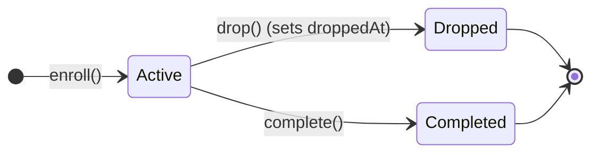

# Design Principles

These are not aspirational goals; they are structural patterns applied consistently across every file in `src/`. Understanding these principles makes predicting SDK behavior natural.

---

## 1. Repository-Interface Pattern

The SDK never imports a database client or ORM (no Prisma, Drizzle, Kysely, or Mongoose). Wherever persistence is required, the module defines a TypeScript interface (`GradeRepository`, `EnrollmentRepository`, `SchedulingRepository`…):

```ts
export interface UserRepository {
  findById(id: Id): Promise<Identity | null>;
  findByExternalRef(ref: string, orgId?: Id): Promise<Identity | null>;
}
```

The host application implements these interfaces against its actual database.

- **Benefit:** Complete database and framework independence. You can switch from SQLite to PostgreSQL, or migrate ORMs, without touching your LMS business logic.
- **Contract:** Repositories must return `null` when a record is not found (never throw), and return the persisted record on `create` and `update`.

---

## 2. Constructor-Injected Services

There are no singletons, service locators, dependency injection containers, decorators, or metadata reflection. Every service takes its dependencies directly in its constructor:

```ts
const enrollmentService = new EnrollmentService(repos, bus, { policy });
const gradingService = new GradingService(gradeRepo, bus, { policy });
```

- **Benefit:** Predictable initialization with zero hidden state. Instantiating services in unit tests requires no mock containers or environment bootstrapping.
- **Convention:** Construct services once during application startup and reuse the instances across requests.

---

## 3. Pure Calculation Functions Separated from Services

Business logic that does not require database access is isolated into standalone pure functions:

```ts
// Pure functions in discendo-sdk/grading
const finalGrade = computeFinalGrade(entriesByCategory, scheme);
const adjustedScore = applyLatePolicy(score, maxScore, daysLate, policy);
const letter = toLetterGrade(finalGrade, scale);

// Pure functions in discendo-sdk/scheduling
const conflicts = findConflicts(occurrences);
const available = checkAvailability(slot, rules);
```

- **Benefit:** Instant previews in UI forms without mutating database state.
- **Testability:** Pure functions can be tested exhaustively with simple inputs and outputs, free from asynchronous timing or database fixtures.

---

## 4. Never Hard-Delete: Status Transitions & Audit Trails

In an educational institution, erasing records destroys academic history and audit compliance. Discendo avoids destructive operations:



- **Enrollments:** Dropping a student updates their status to `'dropped'` and sets `droppedAt: new Date()`. The record is retained.
- **Grades:** Modifying a grade does not overwrite the row. A new `GradeEntry` is inserted, and the previous entry is marked with `supersededBy: newEntry.id`.
- **Schedules:** Cancelling a class sets `status: 'cancelled'` and records a reason. The recurring template remains unchanged.
- **Delegations & Guardians:** Expiring or revoking access records `revokedAt: new Date()`.

---

## 5. UTC Timestamps Everywhere

All timestamps produced or consumed by the SDK are JavaScript `Date` objects representing UTC time:

- Services perform all date calculations, cutoffs, and scheduling math in UTC.
- Timezone conversions for local presentation (e.g., displaying due dates in a student's local timezone) are strictly the responsibility of the host application UI.

---

## 6. Seams, Not Implementations, for Outside Concerns

Discendo deliberately excludes third-party integrations (like emailing, push notifications, plagiarism scanning, and identity protocols). Instead, it defines typed **seams**:

```ts
// Plagiarism check seam in assessment
type PlagiarismCheckHook = (submission: Submission) => Promise<void>;

// Notification seam in communication
interface NotificationSink {
  dispatch(event: NotificationEvent): Promise<void>;
}
```

You implement the seam (e.g. calling Turnitin, SendGrid, or Firebase) and pass it to the service constructor. The SDK coordinates the workflow without binding to external APIs.

---

## 7. Optional Wiring Stays Optional

Every non-core feature is opt-in:

- Omit the `EventBus`, and services run without emitting events.
- Omit the `policy`, and services execute without checking permissions.
- Omit optional repositories (like `delegations` or `guardianLinks`), and the corresponding features remain dormant without throwing errors.

Existing functionality is never broken when optional parameters are omitted.

---

## 8. Authorization Fails Closed

When permission enforcement is active, any ambiguity causes immediate rejection:

- **Missing actor:** Throws `ActorRequiredError`.
- **Unknown actor:** Throws `PermissionDeniedError`.
- **Target entity not found:** Throws `PermissionDeniedError` (not 404).
- **Policy evaluation error:** Throws `PermissionDeniedError`.

Because an unknown target throws the exact same error as a forbidden target, unauthorized callers cannot probe for the existence of private course sections, assignments, or student IDs.

---

## 9. Organizations Are a Hard Wall

In multi-tenant configurations, `orgId` forms an impermeable boundary:

```ts
sameOrg(actorOrgId, resourceOrgId);
```

No user—not even an account-wide `admin`—can perform actions across organization boundaries. Departments provide optional grouping inside an organization, but never cross the organization wall.

---

## 10. Authentication Is Decoupled from Authorization

The SDK does not issue tokens, manage passwords, or maintain sessions:

1. Your host application authenticates incoming requests (via JWT, sessions, cookies, or OAuth) and determines the user's ID.
2. Your application passes `{ actorId }` to the service method.
3. The SDK loads the verified `Identity` from your `UserRepository` and evaluates what that person is permitted to do.

The SDK never accepts roles or permissions directly from caller arguments; it loads them strictly from verified persistence.
