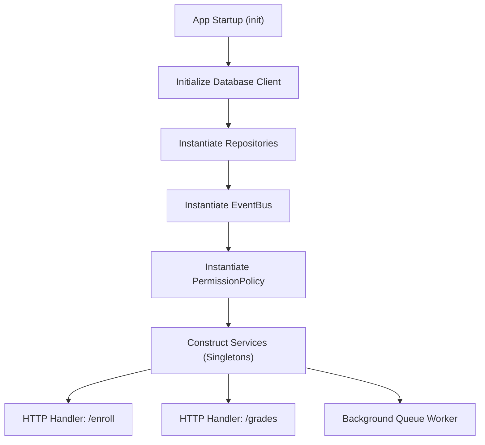

# Services & Wiring

Services in Discendo SDK encapsulate business workflows and domain rules. They coordinate database reads and writes via repository interfaces, enforce access control policies, and emit lifecycle events.

---

## Service Lifecycle

Services have **zero per-request setup cost**. They do not maintain mutable internal session state or cache request data.

::: tip Recommendation: Instantiate Once at Startup
Create your repository and service instances during application initialization (e.g., in a `src/services.ts` container module) and export them for use in your route handlers, server actions, or workers.
:::



---

## Wiring Services

A typical application initializes its service container once:

```ts
// src/lib/services.ts
import { EventBus, createRolePolicy } from "discendo-sdk/core";
import { EnrollmentService } from "discendo-sdk/enrollment";
import { ContentService } from "discendo-sdk/content";
import { GradingService } from "discendo-sdk/grading";
import { SchedulingService } from "discendo-sdk/scheduling";

import {
  userRepo,
  courseRepo,
  enrollmentRepo,
  contentRepo,
  termRepo,
  gradeRepo,
  schedulingRepo,
} from "./db/repositories";

// 1. Core repositories bundle
const repos = {
  users: userRepo,
  courses: courseRepo,
  enrollments: enrollmentRepo,
  content: contentRepo,
  terms: termRepo,
};

// 2. Global event bus
export const bus = new EventBus({
  onHandlerError: (err, event) => {
    console.error(`[EventBus] Error handling ${event.type}:`, err);
  },
});

// 3. Authorization policy (enforces default rules)
export const policy = createRolePolicy();

// 4. Instantiate domain services
export const enrollmentService = new EnrollmentService(repos, bus, {
  policy,
  promoteOnDrop: true, // Automatically promote from waitlist when seat frees
});

export const contentService = new ContentService(repos.content, bus, {
  policy,
});

export const gradingService = new GradingService(gradeRepo, bus, {
  policy,
  repos,
  // Optional locator to resolve section and student from submission ID
  submissionLocator: async (submissionId) => {
    const sub = await submissionRepo.findById(submissionId);
    return sub ? { sectionId: sub.sectionId, userId: sub.userId } : null;
  },
});

export const schedulingService = new SchedulingService(
  schedulingRepo,
  undefined,
  bus,
  {
    enforcement: { policy, repos },
  },
);
```

---

## Error Handling Patterns

Services signal failures using specific typed errors rather than generic HTTP statuses. Handle them gracefully at your API boundary:

```ts
import {
  PermissionDeniedError,
  ActorRequiredError,
  TenantMismatchError,
} from "discendo-sdk/core";
import {
  SectionNotOpenError,
  AlreadyEnrolledError,
  PrerequisiteNotMetError,
} from "discendo-sdk/enrollment";

export function mapErrorToResponse(err: unknown) {
  if (err instanceof PermissionDeniedError) {
    return { status: 403, error: "Forbidden", message: err.message };
  }

  if (err instanceof TenantMismatchError) {
    return {
      status: 403,
      error: "TenantMismatch",
      message: "Resource belongs to another institution",
    };
  }

  if (err instanceof ActorRequiredError) {
    return {
      status: 500,
      error: "InternalError",
      message: "Missing actor context",
    };
  }

  if (err instanceof SectionNotOpenError) {
    return { status: 400, error: "SectionNotOpen", message: err.message };
  }

  if (err instanceof AlreadyEnrolledError) {
    return { status: 409, error: "AlreadyEnrolled", message: err.message };
  }

  if (err instanceof PrerequisiteNotMetError) {
    return { status: 400, error: "PrerequisiteNotMet", details: err.unmet };
  }

  return { status: 500, error: "InternalServerError" };
}
```

---

## Using Services in an HTTP Handler

Here is how an endpoint in a modern TypeScript framework (like [Hono](https://hono.dev)) invokes an SDK service:

```ts
import { Hono } from "hono";
import { enrollmentService } from "./lib/services";
import { mapErrorToResponse } from "./lib/errors";

const app = new Hono();

app.post("/api/sections/:sectionId/enroll", async (c) => {
  // 1. Authenticate the caller (e.g. from session or JWT)
  const currentUser = c.get("user");
  const sectionId = c.req.param("sectionId");
  const { userId, role } = await c.req.json();

  try {
    // 2. Delegate to the service, passing actorId for authorization
    const enrollment = await enrollmentService.enroll(
      { userId, sectionId, role, waitlistIfFull: true },
      { actorId: currentUser.id },
    );

    return c.json({ ok: true, enrollment }, 201);
  } catch (err) {
    const { status, ...body } = mapErrorToResponse(err);
    return c.json(body, status as any);
  }
});
```

---

## Next Steps

- Explore the typed event system in [Events](/concepts/events).
- Learn how rules are evaluated in [Permissions](/concepts/permissions).
