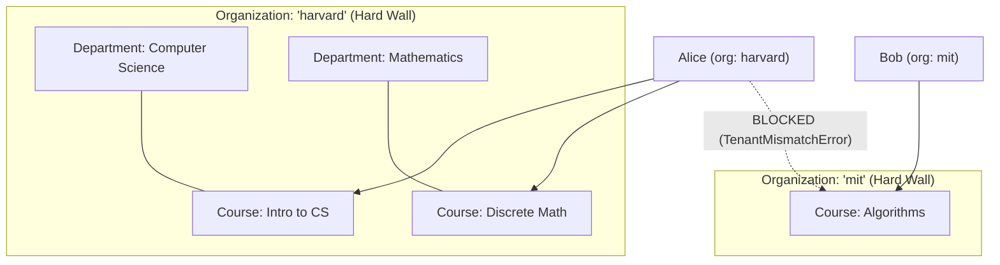

# Tenancy

`discendo-sdk/core` provides multi-tenancy primitives that allow multiple institutions (schools, universities, enterprise training clients) to share a single database and deployment safely.

::: tip Single institution?
If you are building for a single school or company, you can **skip this concept**. Leave `orgId` unset everywhere (`undefined`), and the SDK operates without restrictions.
:::

---

## Organizations vs Departments



| Concept           | Organization                                                         | Department                                                           |
| ----------------- | -------------------------------------------------------------------- | -------------------------------------------------------------------- |
| **Represents**    | An entire institution or enterprise tenant                           | A subject area, faculty, or program inside an institution            |
| **Security Wall** | **Yes:** an impermeable barrier. No one crosses it, not even admins. | **No:** an organizational categorization tool.                       |
| **Set On**        | `Identity.orgId`, `Course.orgId`, `AcademicTerm.orgId`               | `Course.departmentId`                                                |
| **Cross-Access**  | Blocked automatically by `TenantMismatchError`.                      | Permitted. A student can take courses in CS and Math simultaneously. |

---

## Where `orgId` Lives

1. **`Course.orgId`**: Identifies the institution that owns the curriculum. Course sections, enrollments, and content trees **never repeat `orgId`**—they inherit it automatically through their parent course.
2. **`Identity.orgId`**: Identifies the institution the user belongs to.
3. **`AcademicTerm.orgId`**: Optional, represents the academic calendar of that specific institution.

---

## The Rule of Strict Tenant Equality

The SDK evaluates tenant isolation using `sameOrg()`:

> An organization ID matches **the exact same ID, and nothing else**.  
> `"No organization"` (`undefined`) matches **only** `"no organization"`.

```ts
import { sameOrg } from "discendo-sdk/core";

sameOrg("org-harvard", "org-harvard"); // true
sameOrg("org-harvard", "org-mit"); // false
sameOrg(undefined, undefined); // true (single-tenant deployment)
sameOrg("org-harvard", undefined); // false (org member cannot access un-scoped course)
sameOrg(undefined, "org-harvard"); // false (un-scoped person cannot join org course)
```

::: warning Strings are compared strictly
Tenant IDs are case-sensitive strings: `'HARVARD'` is not equal to `'harvard'`.
:::

---

## Where the SDK Enforces Tenancy

Tenancy checks run automatically across every domain:

### 1. Permissions & Policies

Before any action rule is evaluated, the policy checks `sameOrg(actor.orgId, resource.orgId)`. An admin of `org-A` cannot perform any actions on `org-B`, even with the `admin` role.

### 2. Enrollment

`EnrollmentService.enroll()` verifies that the student and the course section belong to the same organization. Cross-tenant enrollment is rejected with `TenantMismatchError` before seat capacities are checked, and no events are emitted.

### 3. External Reference Resolution

During roster imports (`bulkEnroll`), external user IDs are resolved scoped to the organization:

```ts
userRepo.findByExternalRef(row.userExternalRef, orgId);
```

This allows two distinct organizations to share the same student ID format (e.g. employee ID `1001`) without collisions.

### 4. Timetables & Scheduling

In `SchedulingService`, rooms, instructors, student groups, and session templates must all belong to the same organization. The solver will never assign a section to another institution's room.

### 5. Guardians & Family Links

`GuardianService` ensures that the admin, parent, and student all belong to the same institution. A parent in `org-A` cannot access a student in `org-B`.

### 6. Audit Logs

`AdminService.history` returns audit events only for the requesting admin's organization. Queries for another organization yield empty lists.

---

## Deployment Modes

| Deployment Mode               | Configuration                         | Behavior                                                                                                                                                |
| ----------------------------- | ------------------------------------- | ------------------------------------------------------------------------------------------------------------------------------------------------------- |
| **Single-Institution**        | Leave `orgId` undefined everywhere    | Zero overhead. All resources match `undefined === undefined`.                                                                                           |
| **Multi-Tenant SaaS**         | Set `orgId` on all courses and users  | Complete isolation between institutions.                                                                                                                |
| **Mixed (Gradual Migration)** | Some records have `orgId`, some don't | **Not recommended.** An org-scoped user cannot join an un-scoped course. When adding `orgId`, migrate courses and users together in the same migration. |

---

## Handling Errors

When a cross-tenant operation is attempted, the SDK throws `TenantMismatchError`:

```ts
import { TenantMismatchError } from "discendo-sdk/core";

try {
  await enrollmentService.enroll({ userId, sectionId, role: "student" });
} catch (err) {
  if (err instanceof TenantMismatchError) {
    console.error(
      `Tenant mismatch! Expected ${err.expectedOrgId}, got ${err.actualOrgId}`,
    );
    return response.status(403).json({ error: "Tenant mismatch" });
  }
}
```

---

## Next Steps

- Explore the [Core Module Reference](/modules/core).
- Review how courses, terms, and sections are built in the [Build an LMS Tutorial](/tutorial/08-courses).
