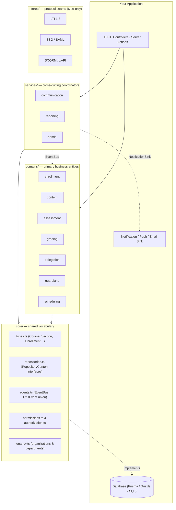
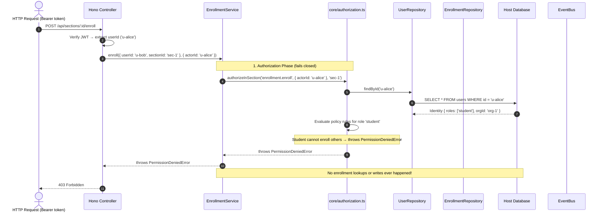

# Architecture

Discendo SDK is built as a set of decoupled, framework-agnostic layers. This page explains the layering rule, how modules talk to each other without depending on each other, and what happens when your application calls a service.

## The layers

The source code under `src/` is split into four layers:



### 1. `src/core/` — the shared vocabulary

The foundation. It exports shared domain types (`Course`, `CourseSection`, `Enrollment`, `Identity`…), the repository interfaces, the `EventBus`, multi-tenancy assertions, and the permission/authorization engine.

::: important The layering rule
`core` **imports nothing else in the SDK**. Every other module may import `core` and its own files, but **never another domain or service**.
:::

This rule is enforced by `test/architecture.test.ts`. If an import crosses domain boundaries, CI fails. That is what guarantees you can import `discendo-sdk/grading` into a project without pulling in `scheduling`, `assessment`, or `communication`.

### 2. `src/domains/` — primary entities

A module belongs in `domains/` if it owns an entity that has its own identity, lifecycle, and database table in the host application:

| Domain       | Primary entity                           | Persistence interface                                                                                    |
| ------------ | ---------------------------------------- | -------------------------------------------------------------------------------------------------------- |
| `enrollment` | Join between user and section            | `EnrollmentRepository`, `EnrollmentRequestRepository`, `GroupRepository`, `CoursePrerequisiteRepository` |
| `content`    | The node hierarchy (pages, assignments…) | `ContentRepository`                                                                                      |
| `assessment` | Submissions, attempts, rubrics           | `SubmissionRepository`, `QuizRepository`, `RubricRepository`                                             |
| `grading`    | Immutable grade entries                  | `GradeRepository`, `GradingConfigRepository`                                                             |
| `delegation` | TA privilege grants                      | `DelegationRepository`                                                                                   |
| `guardians`  | Links between parent and student         | `GuardianLinkRepository`, `GuardianLinkManagementRepository`                                             |
| `scheduling` | Recurring templates and occurrences      | `SchedulingRepository`                                                                                   |

### 3. `src/services/` — cross-cutting coordinators

Modules here **do not own a primary entity**. Instead, they summarize, audit, or react to what domains have produced:

- **`communication`** — announcements, discussion threads, and bridging the `EventBus` into push/email sinks.
- **`reporting`** — attendance calculations, course completion percentages, CSV exports.
- **`admin`** — audit logging via `withAudit` or `AdminService`.

### 4. `src/interop/` — pluggable protocol seams

Type-only interfaces and shapes for standards like LTI 1.3, SAML/OIDC SSO, and SCORM/xAPI packages. They contain **no implementations** — they define the contracts so host applications can plug in standard-compliant tools without coupling the SDK to specific protocol libraries.

---

## How modules coordinate without importing each other

Because `grading` cannot import `assessment`, and `scheduling` cannot import `enrollment`, modules coordinate through three patterns:

### 1. The typed `EventBus`

The primary way modules communicate. A single `EventBus` instance is created at application startup and passed to every service constructor:

```mermaid
sequenceDiagram
  autonumber
  actor Student
  participant EnrollmentService as EnrollmentService
  participant EventBus as EventBus
  participant CommBridge as bridgeEventBusToNotificationSink
  participant PushSink as Your Push/Email Service

  Student->>EnrollmentService: enroll({ userId, sectionId, role: 'student' })
  EnrollmentService->>EnrollmentService: writes to DB via EnrollmentRepository
  EnrollmentService--)EventBus: emit({ type: 'enrollment.enrolled', ... })
  Note over EnrollmentService: Fire-and-forget; does not block caller
  EventBus->>CommBridge: handles 'enrollment.enrolled'
  CommBridge->>PushSink: dispatch({ channel: 'email', ... })
```

The `EventBus` guarantees **failure isolation**: handlers are awaited with `Promise.allSettled`. If a notification handler crashes or times out, the enrollment still succeeds.

### 2. Host-provided locators

When one service needs to look up data that conceptually belongs to another domain, it asks the host for a small locator function instead of importing the other service's repository:

For example, `GradingService` needs to know which course section a submission belongs to in order to check permissions, but it cannot import `AssessmentRepository`. It takes an optional `SubmissionLocator`:

```ts
const grading = new GradingService(gradeRepo, {
  submissionLocator: async (submissionId) => {
    const sub = await myDb.submissions.findUnique({
      where: { id: submissionId },
    });
    return sub ? { sectionId: sub.sectionId, userId: sub.userId } : null;
  },
});
```

### 3. Structural type sharing

When two modules need the same data shape, they define identical or compatible interfaces rather than sharing an import. For example, both `scheduling` and `reporting` deal with attendance records; their attendance types match structurally, so a single host database table satisfies both.

---

## Anatomy of a service call

When your web framework (e.g., a Hono handler or Express route) invokes an SDK service method with permission checking enabled, the call flows through a strict pipeline:



### Key properties of this pipeline:

1. **Authorization comes first.** The service checks permissions before reading or querying the target entity. A caller with no access learns nothing about whether the target exists.
2. **The SDK never trusts caller-supplied roles.** The caller only provides `{ actorId }`. The SDK loads the verified `Identity` directly from `UserRepository`.
3. **Organizations are a hard wall.** If the actor belongs to `org-A` and the course section belongs to `org-B`, `TenantMismatchError` is thrown immediately.
4. **Mutations emit events asynchronously.** Once the database write succeeds, the event is emitted without holding up the response.

---

## Dependency injection without magic

There are no decorators, no reflection, and no global containers in Discendo SDK. Every service takes its dependencies as **plain constructor arguments**:

```ts
// 1. Repositories (you implement)
const repos: RepositoryContext = {
  users,
  courses,
  enrollments,
  content,
  terms,
};

// 2. Event bus (shared singleton)
const bus = new EventBus();

// 3. Permission policy (shared or customized)
const policy = createRolePolicy();

// 4. Construct services once at application startup
export const enrollmentService = new EnrollmentService(repos, bus, { policy });
export const contentService = new ContentService(repos.content, bus, {
  policy,
});
export const gradingService = new GradingService(gradeRepo, bus, { policy });
```

In your HTTP handlers, you import these pre-configured service instances directly.

---

## What's next?

- Learn how to implement your database adapters in [Repositories](/concepts/repositories).
- Learn about the default permission rules in [Permissions](/concepts/permissions).
- Dive into the multi-tenant architecture in [Tenancy](/concepts/tenancy).
