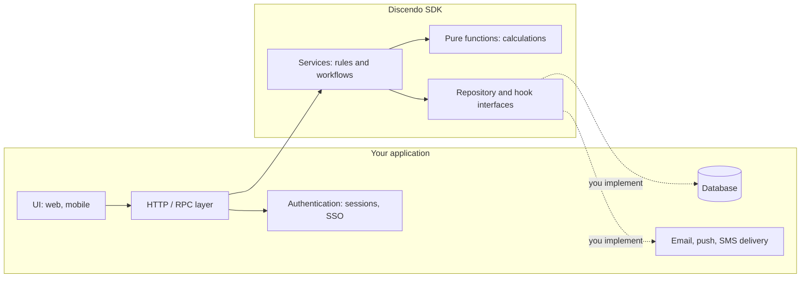

# What is Discendo?

**Discendo SDK** is a TypeScript library that contains the _logic_ of a Learning Management System (LMS): enrolling students, structuring course content, collecting submissions, recording and calculating grades, building timetables, and more. It is not an application. It has no UI, no database and no web server.

You bring those. Discendo supplies the parts that are hard to get right.

> _Discendo_ is Latin for "by learning".

::: warning Early development
The SDK is at **v0.1.0**. It is well tested (more than 1,600 tests), but the API will still change. Each module page lists what is **not** built yet under _Known limitations_.
:::

## The problem it solves

Teams that build an LMS usually take one of two routes:

| Approach                                              | What goes wrong                                                                                                                                                    |
| ----------------------------------------------------- | ------------------------------------------------------------------------------------------------------------------------------------------------------------------ |
| **Adopt a full platform** (Moodle, Canvas, Open edX…) | You inherit its stack, its database schema and its UI, and every customisation is a fight with the platform.                                                       |
| **Build from scratch**                                | You reinvent waitlists, grade histories, late penalties, permission checks, multi-tenant isolation and timetable conflict detection, and get the edge cases wrong. |

Discendo is a third route: **keep your own stack and product, and reuse the domain logic.** It is to an LMS roughly what Stripe's SDK is to payments: the rules and invariants, packaged as a library.

## What you get

Each module is its own import, so you take only what you need:

| Module            | Import                             | What it does                                                                                                                             |
| ----------------- | ---------------------------------- | ---------------------------------------------------------------------------------------------------------------------------------------- |
| **Core**          | `discendo-sdk/core`                | Shared types (`Course`, `CourseSection`, `Enrollment`…), repository interfaces, the `EventBus`, tenancy and permissions                  |
| **Enrollment**    | `discendo-sdk/enrollment`          | Enroll and drop, capacity and waitlists, auto-promotion, bulk roster import, enrollment requests, prerequisites, student groups          |
| **Content**       | `discendo-sdk/content`             | The course content tree, publishing and versioning, prerequisite gating                                                                  |
| **Assessment**    | `discendo-sdk/assessment`          | Submissions, attempt limits, quizzes with randomization, rubrics, peer review, a plagiarism-check hook                                   |
| **Grading**       | `discendo-sdk/grading`             | Grade history (superseded, never overwritten), weighted final grades, late policies, letter grades, extensions and excusals, curves, GPA |
| **Delegation**    | `discendo-sdk/delegation`          | Instructors granting selected permissions to their TAs, and revoking them                                                                |
| **Guardians**     | `discendo-sdk/guardians`           | Read-only parent and guardian access through managed links                                                                               |
| **Scheduling**    | `discendo-sdk/scheduling`          | Recurring class templates, occurrences, conflict detection, availability, room matching and an auto-scheduling solver                    |
| **Calendar**      | `discendo-sdk/scheduling/calendar` | Open, locked and closed date windows, and iCal export of due dates                                                                           |
| **Communication** | `discendo-sdk/communication`       | Announcements, threaded replies, and a bridge from events to your notification sink                                                      |
| **Reporting**     | `discendo-sdk/reporting`           | Attendance, completion percentages, CSV export                                                                                           |
| **Admin**         | `discendo-sdk/admin`               | Audit logging (`withAudit`, `AdminService`)                                                                                              |
| **Interop**       | `discendo-sdk/interop`             | Type-only seams for LTI, SSO and SCORM/xAPI                                                                                              |

## What you build

Discendo deliberately stays out of a few areas. Your application owns:

- **Persistence.** You implement small repository interfaces (`findById`, `create`, `update`…) over Prisma, Drizzle, raw SQL or anything else. The SDK has **zero runtime dependencies** and never imports a database client.
- **Authentication.** The SDK never logs anyone in. You tell it _who_ is acting (`{ actorId }`), and it decides _whether they may_.
- **Transport and UI.** REST, GraphQL, tRPC, server actions, a CLI: whatever you use, you call SDK services from it.
- **Delivery.** The SDK emits events and calls notification hooks. Sending the email is up to you.
- **User profiles.** The SDK's `Identity` holds only an id, roles and an organization. Names, emails and avatars stay in your own user table.

## Who it is for

The same model covers one tutor and a whole university:

- **A single tutor** might use `enrollment` + `grading` with an in-memory or SQLite store.
- **A school** adds `content`, `assessment`, `guardians` (a parent portal) and `scheduling` (timetables).
- **A multi-campus institution or SaaS provider** turns on **organizations** (hard tenant walls), **departments**, **permission enforcement** and **audit logging**.

## Guarantees you can rely on

These hold in every module (see [Design Principles](/concepts/design-principles)):

- **Nothing is hard-deleted.** Grades are superseded, enrollments dropped, occurrences cancelled, grants revoked.
- **Permissions fail closed.** With a policy configured, anything not clearly allowed is refused, and an unknown id is refused exactly like a forbidden one.
- **Organizations are a hard wall.** Nobody acts across one, not even an admin.
- **UTC everywhere.** Converting to local time is a presentation concern.
- **Optional means optional.** Events, hooks, enforcement and optional repositories can all be left out.

## Where to go next

- **Try it in five minutes:** [Quick Start](/introduction/quick-start)
- **Understand how it fits together:** [Architecture](/introduction/architecture)
- **Build a real LMS:** [the tutorial](/tutorial/), with Bun, Hono and Drizzle

