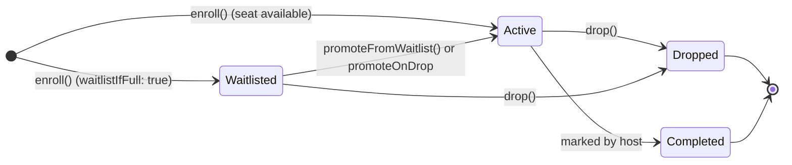

# Enrollment

`discendo-sdk/enrollment` handles roster membership: enrolling students and instructors into sections, managing seat capacities and waitlists, processing drop requests, importing bulk rosters, and approving self-service student enrollment requests.

Enrollment is also the foundation of authorization: a user's permissions in a section depend on having an `'active'` enrollment record.

---

## At a Glance

|                  |                                                                                                                                                                                                                                            |
| ---------------- | ------------------------------------------------------------------------------------------------------------------------------------------------------------------------------------------------------------------------------------------ |
| **Import**       | `import { EnrollmentService, EnrollmentRequestService, GroupService, PrerequisiteService } from 'discendo-sdk/enrollment'`                                                                                                                 |
| **Repositories** | `users`, `courses`, `enrollments`, plus optional `enrollmentRequests`, `groups`, and `coursePrerequisites` in `RepositoryContext`                                                                                                          |
| **Events**       | `enrollment.enrolled`, `enrollment.dropped`, `enrollment.promoted`, `enrollment.promotionFailed`, `enrollment.requested`, `enrollment.requestDecided`                                                                                      |
| **Permissions**  | `enrollment.enroll`, `enrollment.bulkEnroll`, `enrollment.drop`, `enrollment.viewRoster`, `enrollment.promoteWaitlist`, `enrollment.reviewRequest`, `enrollment.grantRole.<role>`, `enrollment.manageGroups`, `course.managePrerequisites` |
| **Enforcement**  | `EnrollmentService`: opt-in (`{ policy }`). `EnrollmentRequestService`: mandatory (`policy` required).                                                                                                                                     |

---

## The Lifecycle of an Enrollment



- **Active:** Holds an open seat in the section. Confers section operational roles.
- **Waitlisted:** Held in a FIFO queue when the section is full. Confers no roles.
- **Dropped:** Marked when a student withdraws. Historical record preserved; never deleted.
- **Completed:** Marked by your application at the end of a term. Students keep read-only access to their past grades and published content.

---

## `EnrollmentService`

```ts
new EnrollmentService(
  repos: RepositoryContext,
  events?: EventBus,
  options?: {
    policy?: PermissionPolicy
    promoteOnDrop?: boolean
    enforcePrerequisites?: boolean
    gradeSource?: { getCourseGrade(userId: string, courseId: string): Promise<number | null> }
  }
)
```

### `enroll(opts, actor?): Promise<Enrollment>`

Enrolls a user into a section.

```ts
await enrollmentService.enroll(
  {
    userId: "u-alice",
    sectionId: "sec-101",
    role: "student",
    waitlistIfFull: true,
  },
  { actorId: "u-admin" },
);
```

#### Invariants & Execution Steps:

1. **Authorization:** Checks `enrollment.enroll` for the section and `enrollment.grantRole.<role>`.
2. **Idempotency:** If the user already has an active, waitlisted, or completed enrollment, that existing record is returned without modifications or duplicate events.
3. **Tenant Wall:** The user and section course must belong to the exact same organization, or `TenantMismatchError` is thrown.
4. **Section Status:** Sections only accept enrollments when `status === 'published'`. Draft sections require `allowDraft: true`. Archived sections never accept enrollments.
5. **Capacity & Waitlist Queue:**
   - If people are already waiting on the waitlist, a newcomer **never jumps the line** to take a freed seat.
   - If the section is full, setting `waitlistIfFull: true` creates a `'waitlisted'` enrollment. Otherwise, it throws `Section is at capacity`.
   - Uses atomic `createIfSeatFree` if implemented on the repository to prevent race conditions.

### `drop(enrollmentId, actor?): Promise<Enrollment>`

Transitions an active or waitlisted enrollment to `'dropped'`, setting `droppedAt: new Date()`.

```ts
await enrollmentService.drop("enr-123", { actorId: "u-alice" });
```

- **Permission:** Admins and instructors can drop anyone (`enrollment.drop`). Students can drop their own enrollments (`allowSelf: true`).
- **Completed enrollments:** Cannot be dropped (throws `EnrollmentNotDroppableError`).
- **Auto-Promotion (`promoteOnDrop`):** If enabled, dropping an active enrollment automatically promotes the longest-waiting waitlisted student to fill the vacant seat.

### `promoteFromWaitlist(sectionId, actor?, options?): Promise<Enrollment[]>`

Promotes students from the waitlist into free seats, ordered by waitlist entry time (`enrolledAt ASC`).

- Requires `enrollment.promoteWaitlist` (admin or instructor).
- Uses atomic `promoteIfSeatFree` if implemented on the repository.
- Emits `enrollment.promoted` with `trigger: 'manual'`.

### `bulkEnroll(sectionId, rows, actor?, options?): Promise<BatchReport>`

Processes mass roster feeds (e.g. from an SIS sync):

```ts
const report = await enrollmentService.bulkEnroll(
  "sec-101",
  [
    { userExternalRef: "SIS-1001", role: "student" },
    { userExternalRef: "SIS-1002", role: "student" },
  ],
  { actorId: "u-admin" },
);

console.log(`Success: ${report.succeeded}, Failed: ${report.failed.length}`);
```

- Each external reference is resolved via `userRepo.findByExternalRef(ref, orgId)`.
- If an individual row lacks permission (e.g. attempting to grant `instructor` without admin rights), that row fails with `"not permitted"` while the rest of the batch continues.

---

## `EnrollmentRequestService`

Enables self-service student enrollment workflows with administrative approval:

```ts
const requestService = new EnrollmentRequestService(repos, policy, bus);

// 1. Student requests a seat
const req = await requestService.request(
  "sec-101",
  { note: "Need this to graduate" },
  { actorId: "u-student" },
);

// 2. Staff reviews and accepts
await requestService.accept(
  req.id,
  { waitlistIfFull: true },
  { actorId: "u-advisor" },
);

// Or modifies the request to an alternate section of the same course:
await requestService.modify(
  req.id,
  "sec-102",
  { note: "Section 101 full, placed in 102" },
  { actorId: "u-advisor" },
);

// Or rejects:
await requestService.reject(
  req.id,
  { note: "Prerequisites missing" },
  { actorId: "u-advisor" },
);
```

---

## `GroupService`

Manages student study and lab groups within a course section:

```ts
const groups = new GroupService(repos, { policy });

// Create a study group
const group = await groups.createGroup(
  "sec-101",
  {
    name: "Lab Group A",
    maxSize: 4,
    groupSet: "midterm-projects",
  },
  { actorId: "u-instructor" },
);

// Add member
await groups.addMember(group.id, "u-student", { actorId: "u-instructor" });
```

---

## `PrerequisiteService`

Manages and verifies course prerequisites:

```ts
const prereqs = new PrerequisiteService(repos);

// Add prerequisite: must complete CS101 before CS201
await prereqs.addPrerequisite({
  courseId: "course-cs201",
  requiredCourseId: "course-cs101",
  type: "prerequisite",
  minGrade: 70, // optional minimum percentage
});

// Verifies graph for cycles: throws CircularPrerequisiteError if a loop is detected
```

---

## Errors

| Error                             | Cause                                                                                  |
| --------------------------------- | -------------------------------------------------------------------------------------- |
| `SectionNotOpenError`             | Attempted to enroll in a draft (without `allowDraft`) or archived section.             |
| `AlreadyEnrolledError`            | Duplicate enrollment requested.                                                        |
| `EnrollmentNotDroppableError`     | Attempted to drop a completed enrollment.                                              |
| `RequestNotPendingError`          | Attempted to accept, reject, or modify an enrollment request that was already settled. |
| `InvalidRequestModificationError` | Modified request pointed to the same section or to a different course.                 |
| `CircularPrerequisiteError`       | Adding a course prerequisite would introduce a dependency cycle.                       |
| `PrerequisiteNotMetError`         | Student does not meet the necessary prerequisites to enroll.                           |

---

## Known Limitations

- **Seat counts include staff:** `countActive` counts all active roles (including instructors and TAs) in the section. Plan your capacities accordingly.
- **Roster imports are not an all-or-nothing transaction:** `bulkEnroll` processes rows sequentially, committing each successful enrollment individually.
