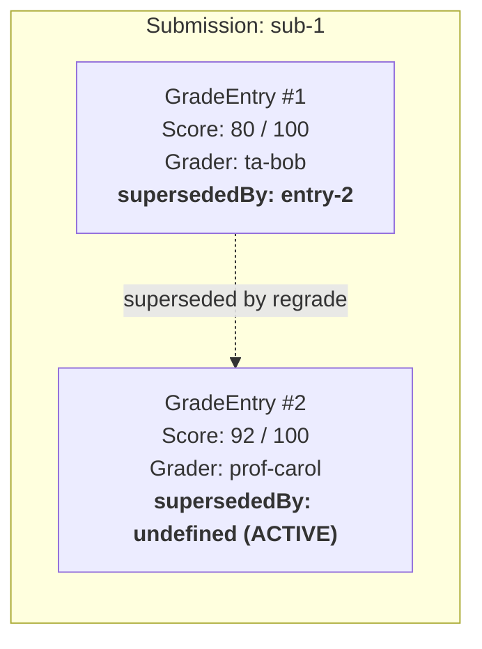

# Grading

`discendo-sdk/grading` manages the gradebook: recording grades without overwriting past entries, calculating weighted final percentages with drop-lowest rules, deducting late penalties, managing student accommodations, applying grading curves, and computing GPA.

---

## At a Glance

|                    |                                                                                                                                                          |
| ------------------ | -------------------------------------------------------------------------------------------------------------------------------------------------------- |
| **Import**         | `import { GradingService, AccommodationService, computeFinalGrade, applyLatePolicy, toLetterGrade, applyCurve, computeGpa } from 'discendo-sdk/grading'` |
| **Repositories**   | `GradeRepository`, `GradingConfigRepository`, `AccommodationRepository`                                                                                  |
| **Pure Functions** | `computeFinalGrade`, `applyLatePolicy`, `effectiveDueAt`, `daysLate`, `toLetterGrade`, `applyCurve`, `curveEntries`, `computeGpa`, `toGpaPoints`         |
| **Events**         | `grading.gradePosted`, `grading.extensionGranted`, `grading.excused`                                                                                     |
| **Permissions**    | `grading.record`, `grading.viewGrades`, `grading.computeFinal`, `grading.manageExtensions`, `grading.manageExcusals`, `grading.manageCurve`              |
| **Enforcement**    | Opt-in via constructor options `{ policy, repos, submissions }`                                                                                          |

---

## The Immutable Audit Trail

In an academic institution, changing a grade must never erase who entered the previous score. `GradingService` achieves this by treating all `GradeEntry` rows as immutable:



- When regrading, `recordGrade()` inserts a brand-new `GradeEntry` and updates the old entry's `supersededBy` pointer.
- Only current (non-superseded) entries are counted in final grade calculations.
- Past grading disputes can always be inspected with complete timestamp and grader tracking.

---

## Data Models

```ts
interface GradeEntry {
  id: string;
  submissionId: string;
  userId: string;
  score: number;
  maxScore: number;
  graderId: string;
  gradedAt: Date;
  supersededBy?: string; // Set when superseded by a regrade
}

interface GradeCategory {
  name: string;
  weight: number; // 0 to 1; all categories in a scheme sum to 1.0
  dropLowestN?: number; // Drop lowest N grades in this category
}

interface GradingScheme {
  categories: GradeCategory[];
}

type LatePolicy =
  | { kind: "none" }
  | { kind: "flatPenalty"; percentPerDay: number; maxPenaltyPercent?: number }
  | { kind: "cutoff"; afterDays: number }; // Zero credit after N days

interface GradeScaleBand {
  minPercent: number;
  label: string; // e.g. 'A', 'A-', 'Pass'
}
type GradeScale = GradeScaleBand[];
```

---

## `GradingService`

```ts
new GradingService(
  grades: GradeRepository,
  events?: EventBus,
  enforcement?: {
    policy: PermissionPolicy
    repos: RepositoryContext
    submissions: SubmissionLocator
  },
  options?: {
    allowExtraCredit?: boolean // Allow score > maxScore (default: false)
    systemGraders?: string[]    // Allow system: graders without actor context
  }
)
```

### `recordGrade(...)`

Records a score for a student submission:

```ts
// First grade entry
const entry = await grading.recordGrade(
  "sub-101",
  "u-alice",
  85, // score
  100, // maxScore
  "u-prof",
  undefined, // previousEntryId (none)
  { actorId: "u-prof" },
);

// Regrade: pass the previous entry's ID to supersede it
const regraded = await grading.recordGrade(
  "sub-101",
  "u-alice",
  92,
  100,
  "u-prof",
  entry.id, // previousEntryId
  { actorId: "u-prof" },
);
```

- Requires `grading.record` permission (instructors, TAs).
- Scores must be non-negative, finite numbers. `score > maxScore` is rejected unless `allowExtraCredit: true` is configured.
- Emits `grading.gradePosted`.

### `recordGroupGrade(...)`

Grades a collaborative submission for multiple students simultaneously:

```ts
const entries = await grading.recordGroupGrade(
  "sub-102",
  ["u-alice", "u-bob", "u-charlie"],
  95,
  100,
  "u-prof",
  {},
  { actorId: "u-prof" },
);
```

Creates a distinct `GradeEntry` for each member, preserving individual audit trails.

---

## Pure Calculation Functions

All grading arithmetic is separated into pure functions in `discendo-sdk/grading`. They can be run in the browser or on the server without touching the database:

### Weighted Final Grades (`computeFinalGrade`)

```ts
import { computeFinalGrade } from "discendo-sdk/grading";

const entriesByCategory = new Map([
  ["homework", [entry1, entry2, entry3]], // dropLowestN: 1 drops the lowest
  ["exams", [examEntry]],
]);

const scheme: GradingScheme = {
  categories: [
    { name: "homework", weight: 0.4, dropLowestN: 1 },
    { name: "exams", weight: 0.6 },
  ],
};

const finalPercent = computeFinalGrade(entriesByCategory, scheme);
// Renormalizes automatically if some categories have no recorded grades yet
```

### Late Penalties (`applyLatePolicy`)

```ts
import { applyLatePolicy } from "discendo-sdk/grading";

const adjusted = applyLatePolicy(90, 100, 2, {
  kind: "flatPenalty",
  percentPerDay: 5, // -5% per day late
  maxPenaltyPercent: 30,
});
// 90 - (100 * 0.10) = 80
```

### Letter Grade Conversion (`toLetterGrade`)

```ts
import { toLetterGrade } from "discendo-sdk/grading";

const scale = [
  { minPercent: 90, label: "A" },
  { minPercent: 80, label: "B" },
  { minPercent: 70, label: "C" },
  { minPercent: 60, label: "D" },
  { minPercent: 0, label: "F" },
];

console.log(toLetterGrade(88.5, scale)); // 'B'
```

### Grade Curves and GPA

```ts
import {
  applyCurve,
  computeGpa,
  STANDARD_GPA_SCALE,
} from "discendo-sdk/grading";

// Linear curve: add 5 points to all scores
const curvedScores = applyCurve([72, 85, 91], { kind: "addPoints", points: 5 });

// Calculate GPA across multiple courses
const gpa = computeGpa(
  [
    { grade: "A", credits: 4 },
    { grade: "B", credits: 3 },
  ],
  STANDARD_GPA_SCALE,
);
console.log(`GPA: ${gpa.toFixed(2)}`); // 3.57
```

---

## Accommodations (`AccommodationService`)

Manages individual student deadline extensions and excused assignments:

```ts
const accommodations = new AccommodationService(accommodationRepo, { policy });

// Give Alice 48 hours extra time on Lab 1
await accommodations.grantExtension(
  {
    contentId: "assign-lab1",
    userId: "u-alice",
    extraSeconds: 48 * 3600,
    reason: "Medical accommodation",
  },
  { actorId: "u-instructor" },
);

// Excuse Bob from Quiz 2 (excluded from final grade computation)
await accommodations.grantExcusal(
  {
    contentId: "quiz-2",
    userId: "u-bob",
    reason: "Approved athletic absence",
  },
  { actorId: "u-instructor" },
);
```

---

## Known Limitations

- **No historical point-in-time grade reconstruction:** `computeFinalGrade` runs against current non-superseded entries. Reconstructing what a gradebook looked like on a past date requires filtering entries manually by `gradedAt`.
- **Grade schemes are section-wide:** Custom grading schemes per individual student are not supported; use `AccommodationService` excusals instead.
