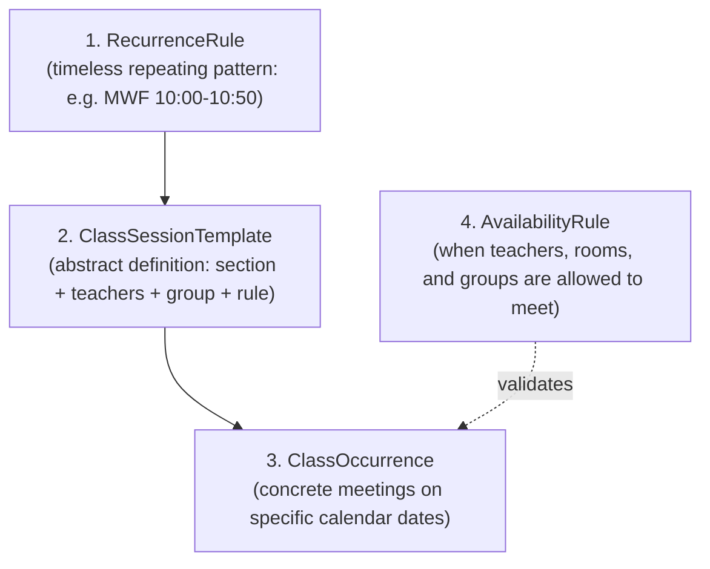

# Scheduling Overview

`discendo-sdk/scheduling` manages academic timetables and class routines. It is the largest and most mathematically complex module in the SDK, providing constraint verification, room allocation, teacher availability checking, and an automated backtracking solver.

---

## Why Four Separate Layers?

Scheduling in educational institutions is notoriously difficult because real-world exceptions are inevitable: a teacher calls in sick, a room needs maintenance, or an exam moves to an auditorium.

To handle real-world fluidity without corrupting recurring timetables, Discendo separates scheduling into **four distinct layers**:

1. **`RecurrenceRule`**: An abstract, RFC 5545-inspired repeating pattern (`freq: 'WEEKLY'`, `interval: 1`, `byDay: ['MO', 'WE', 'FR']`).
2. **`ClassSessionTemplate`**: Connects a course section, assigned teachers, a student group, and room requirements to a recurrence rule. Still timeless.
3. **`ClassOccurrence`**: A single meeting on a concrete calendar date (e.g. October 14, 2026 at 10:00 AM). **Exceptions are made to occurrences, never to the template.**
4. **`AvailabilityRule`**: Resource constraints declaring when instructors, rooms, and student cohorts are free to be scheduled.

---

## Submodule Navigation

Explore each part of the scheduling module:

| Section                                                                    | Description                                                                                                                                  |
| -------------------------------------------------------------------------- | -------------------------------------------------------------------------------------------------------------------------------------------- |
| [**Templates & Occurrences**](/modules/scheduling/templates-occurrences)   | Creating recurring session templates, materializing occurrences across date windows, and handling single-occurrence cancellations and moves. |
| [**Conflicts & Availability**](/modules/scheduling/conflicts-availability) | Pure double-booking conflict detection, teacher working hours, and validating bookings via `checkAll`.                                       |
| [**Rooms & Groups**](/modules/scheduling/rooms-groups)                     | Managing physical rooms, feature matching (labs, projectors), capacity limits, student cohorts, and teacher qualifications.                  |
| [**Auto-Scheduling Solver**](/modules/scheduling/solver)                   | Automated timetable generation using backtracking constraint satisfaction. Proposes conflict-free plans before committing to the database.   |
| [**Calendar & iCal**](/modules/scheduling/calendar)                        | Evaluating open/locked/closed content windows and exporting calendar due dates via standard iCalendar (`.ics`).                              |

---

## Integration with Other Modules

- **Permissions:** Opt-in via `{ enforcement: { policy, repos } }`. Enforces `scheduling.view`, `scheduling.manage`, and `scheduling.manageOccurrence`.
- **Tenancy:** Enforces strict organization isolation: rooms (`Room.orgId`), teachers, groups, and course sections must belong to the same organization.
- **Attendance:** Shares structural types with `discendo-sdk/reporting`, allowing a single attendance table to serve both live sessions and analytics.
- **Events:** Emits `scheduling.occurrenceCancelled` and `scheduling.occurrenceRescheduled`.
