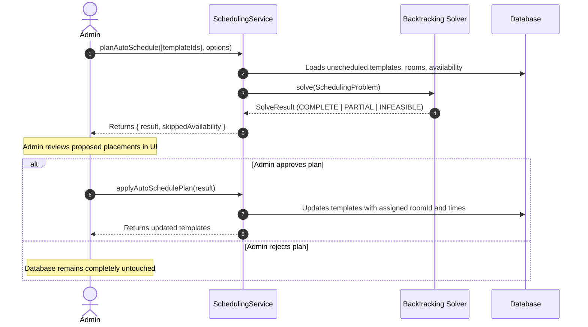

# Auto-Scheduling Solver

Building conflict-free timetables by hand for dozens of courses, rooms, and professors is exhausting. `discendo-sdk/scheduling` includes an automated backtracking solver that calculates conflict-free room and time assignments.

---

## Two-Phase Architecture: Plan then Apply

The solver **never writes directly to your database**. It uses a two-phase workflow so staff can preview, audit, or tweak proposed placements before committing changes:



---

## Step 1: Create Unscheduled Templates

Templates can exist with empty room IDs and times. The solver will find suitable slots:

```ts
const template = await schedulingRepo.createTemplate({
  sectionId: "sec-physics-101",
  teacherIds: ["u-prof-jane"],
  groupId: "cohort-physics-1",
  rule: { freq: "WEEKLY", interval: 1, byDay: ["MO", "WE", "FR"] },
  startTime: "10:00", // Used to derive duration (e.g. 50 minutes)
  endTime: "10:50",
  timezone: "UTC",
  validFrom: new Date("2026-09-01"),
  requiredRoomFeatures: ["lab"],
});
```

---

## Step 2: Plan the Schedule

Run the solver against a set of template IDs:

```ts
const { result, skippedAvailability } =
  await schedulingService.planAutoSchedule(
    [template.id],
    {
      candidateSlotsPerDay: ["09:00", "10:00", "11:00", "13:00", "14:00"],
      days: ["MO", "TU", "WE", "TH", "FR"],
    },
    { actorId: "u-admin" },
  );

console.log(result.status); // 'COMPLETE' | 'PARTIAL' | 'INFEASIBLE'
console.log(result.placements); // [{ sessionId, roomId, days, startTime, endTime }]
console.log(result.unplaced); // [] if all sessions placed
```

### Result Statuses:

- **`COMPLETE`**: Every requested template was successfully placed without conflicts.
- **`PARTIAL`**: Some templates were placed, but others could not be satisfied (returned in `result.unplaced`).
- **`INFEASIBLE`**: No valid placements could be found for the given constraints.

---

## Step 3: Apply the Plan

Once approved by a human administrator, apply the calculated plan:

```ts
if (result.status !== "INFEASIBLE") {
  const updatedTemplates = await schedulingService.applyAutoSchedulePlan(
    result,
    { actorId: "u-admin" },
  );
  console.log(
    `Updated ${updatedTemplates.length} templates with assigned rooms and times`,
  );
}
```

Templates that could not be placed are left untouched for manual assignment.

---

## Soft Constraints & Heuristics

The backtracking algorithm scores valid placement candidates using soft constraints (`solver/soft-constraints.ts`):

1. **Room Continuity:** Prefers scheduling all weekly meetings of a section in the same physical classroom.
2. **Teacher Preference:** Prioritizes slots matching the instructor's declared preferred hours.
3. **Session Spacing:** Discourages scheduling multiple lectures of the same course on back-to-back consecutive days when alternative spacing exists.

---

## Known Limitations

- **NP-Hard complexity:** Backtracking search explores permutations. For very large problems (>500 simultaneous unplaced templates), bound your search space with targeted candidate slot windows.
- **Single room per template:** The solver assumes all days of a weekly template use the same room. A course requiring a classroom on Mondays and a lab on Fridays should be modeled as two separate templates.
