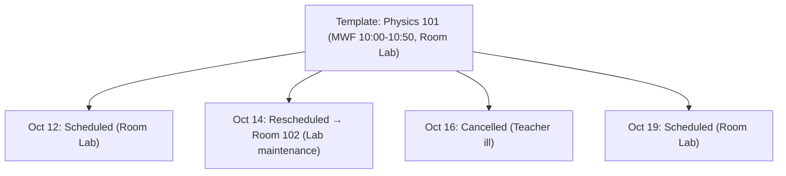

# Templates & Occurrences

The core scheduling workflow separates the abstract recurring timetable pattern from the concrete calendar events where teachers and students actually meet.

---

## Data Models

### `RecurrenceRule`

```ts
type Weekday = "MO" | "TU" | "WE" | "TH" | "FR" | "SA" | "SU";

interface RecurrenceRule {
  freq: "WEEKLY";
  interval: number; // 1 = weekly, 2 = bi-weekly
  byDay: Weekday[]; // Days the session repeats
  raw?: string; // Optional RFC 5545 RRULE string
}
```

### `ClassSessionTemplate`

The recurring master schedule for a course section:

```ts
interface ClassSessionTemplate {
  id: string;
  sectionId: string;
  teacherIds: string[];
  groupId?: string; // Target student group / cohort
  roomId?: string; // Room assigned by staff or solver
  rule: RecurrenceRule;
  startTime: string; // "HH:MM" in 24-hour UTC (e.g. "09:00")
  endTime: string; // "HH:MM" in 24-hour UTC (e.g. "09:50")
  timezone: string; // Reference timezone (e.g. "UTC")
  validFrom: Date;
  validUntil?: Date;
  requiredRoomFeatures?: string[]; // e.g. ['lab', 'projector']
}
```

### `ClassOccurrence`

A single, dated meeting generated from a template:

```ts
interface ClassOccurrence {
  id: string;
  templateId: string;
  date: Date; // Calendar date of meeting (UTC)
  startTime: string; // Overridable "HH:MM"
  endTime: string; // Overridable "HH:MM"
  roomId?: string; // Overridable room
  teacherIds: string[]; // Overridable substitute instructors
  status: "scheduled" | "cancelled";
  cancellationReason?: string;
}
```

---

## Materializing Calendar Occurrences

Recurring rules do not sit in your database as thousands of pre-calculated rows. Instead, you materialize occurrences across rolling date windows (e.g., for the upcoming semester):

```ts
const occurrences = await schedulingService.materializeOccurrences(
  template.id,
  new Date("2026-09-01"),
  new Date("2026-12-15"),
  { actorId: "u-admin" },
);
```

### Idempotency Guarantee

`materializeOccurrences` is safe to run repeatedly (e.g., via a daily cron job). It only creates occurrences for dates that have not yet been materialized. Existing occurrences—including those previously cancelled or moved—are preserved.

---

## Handling Real-World Exceptions

When an instructor is sick or a room is flooded, you **never alter the template**. You modify only the affected `ClassOccurrence`:



### 1. Cancelling a Single Class

```ts
await schedulingService.cancelOccurrence(occurrence.id, "Instructor illness", {
  actorId: "u-instructor",
});
```

- Sets `status: 'cancelled'` and records `cancellationReason`.
- Emits `scheduling.occurrenceCancelled`.
- The template and future meetings remain completely unaffected.

### 2. Rescheduling a Single Meeting

```ts
await schedulingService.rescheduleOccurrence(
  occurrence.id,
  {
    roomId: "room-alt-102",
    startTime: "11:00",
    endTime: "11:50",
  },
  { actorId: "u-instructor" },
);
```

- Overrides the room or time for this specific date only.
- Emits `scheduling.occurrenceRescheduled`.

---

## Attendance for Occurrences

Once an occurrence date arrives, instructors can record attendance:

```ts
await schedulingService.recordAttendanceForOccurrence(
  occurrence.id,
  [
    { userId: "stu-alice", status: "present" },
    { userId: "stu-bob", status: "absent" },
  ],
  { actorId: "u-instructor" },
);
```

Attendance shapes align structurally with `discendo-sdk/reporting`, ensuring unified reporting across live timetables and analytics.

---

## Known Limitations

- **Weekly recurrence only:** The native recurrence engine supports `freq: 'WEEKLY'`. Monthly, annual, or custom cycle patterns (e.g. Day 1–6 rolling cycles) require external RRULE evaluation.
