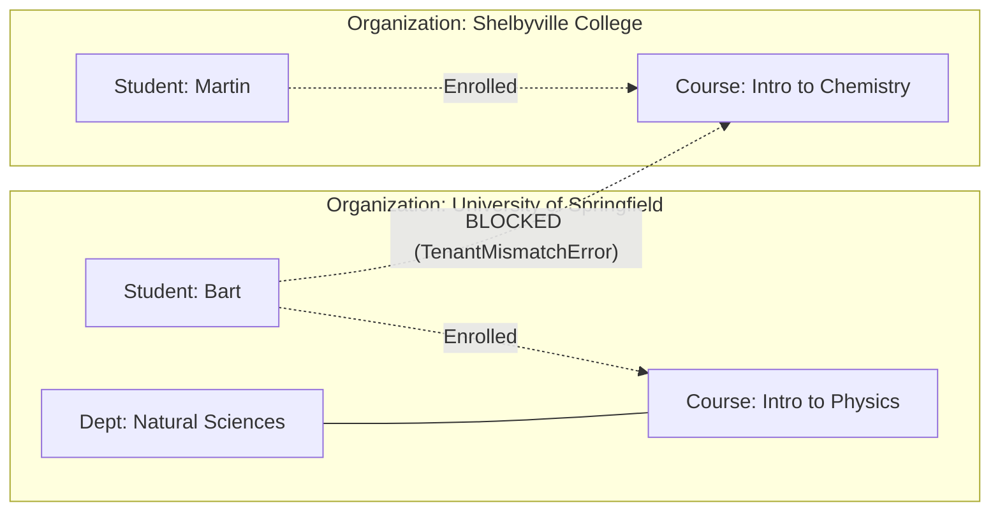

# 7. Organizations & Departments

If your LMS serves multiple schools, corporate clients, or distinct university campuses from a single deployment, you need strict tenant isolation. In this chapter, we will configure organizations and departments.

---

## The Tenant Isolation Model



- **Organization (`orgId`):** The strict security boundary. No user—including account-wide `admin` users—can perform operations across organizations.
- **Department (`departmentId`):** An optional grouping of courses _inside_ an organization (e.g. "School of Engineering", "Department of Mathematics"). It is for categorization and reporting, not an access wall.

---

## 1. Setting Up Multi-Tenant Data

Let's write a route to create organizations and verify tenant scoping:

```ts
// src/routes/organizations.ts
import { Hono } from "hono";
import { db } from "../db";
import { organizations } from "../db/schema";
import { requireAuth } from "../lib/middleware";

export const orgRoutes = new Hono();

// Create an organization (Platform Admin only)
orgRoutes.post("/", requireAuth, async (c) => {
  const { name } = await c.req.json();
  const user = c.get("user");

  if (!user.roles.includes("admin")) {
    return c.json(
      { error: "Forbidden", message: "Platform admin role required" },
      403,
    );
  }

  const id = `org-${crypto.randomUUID().slice(0, 8)}`;
  await db.insert(organizations).values({
    id,
    name,
    createdAt: new Date(),
  });

  return c.json({ ok: true, organization: { id, name } }, 201);
});
```

---

## 2. Scoping Courses and Users

When creating users and courses in a multi-tenant setup, always stamp them with `orgId`:

```ts
// 1. Create a course scoped to Springfield University
await db.insert(courses).values({
  id: "course-phys101",
  title: "Physics 101",
  orgId: "org-springfield",
  departmentId: "dept-sciences",
  createdAt: new Date(),
});

// 2. Course sections inherit tenant from their parent course automatically!
await db.insert(courseSections).values({
  id: "sec-phys101-a",
  courseId: "course-phys101", // Inherits org-springfield
  status: "published",
  createdAt: new Date(),
});
```

Course sections, enrollments, and content trees **never store `orgId` directly**. They inherit it through their course.

---

## 3. How the SDK Protects Tenant Walls

When a student attempts to enroll in a section, `EnrollmentService.enroll()` verifies the tenant:

```ts
// Alice belongs to Shelbyville ('org-shelbyville')
// Section belongs to Springfield ('org-springfield')

await enrollmentService.enroll(
  {
    userId: "u-alice-shelbyville",
    sectionId: "sec-phys101-a",
    role: "student",
  },
  { actorId: "u-advisor" },
);
```

### What Happens:

1. The service loads the section's course and extracts `course.orgId` (`'org-springfield'`).
2. The service loads Alice's `Identity` from `UserRepository` and extracts `user.orgId` (`'org-shelbyville'`).
3. It evaluates `sameOrg('org-shelbyville', 'org-springfield')` → returns `false`.
4. It immediately throws `TenantMismatchError`.
5. No database updates are executed, no waitlists are joined, and no events are emitted.

Our `handleDomainError` handler catches `TenantMismatchError` and responds with `403 Forbidden`:

```json
{
  "error": "TenantMismatch",
  "message": "You cannot perform actions across institution boundaries"
}
```

---

## 4. Single-Tenant vs Multi-Tenant Switch

To operate Academix as a single-institution LMS:

- Simply leave `orgId` as `null` or `undefined` when inserting users and courses.
- The SDK treats `undefined === undefined` as matching everywhere with zero overhead.

---

## Next Steps

Now we enter **Phase 3: Teaching & Learning**, starting with curriculum setup in [Chapter 8: Courses, Terms & Sections](/tutorial/08-courses).
