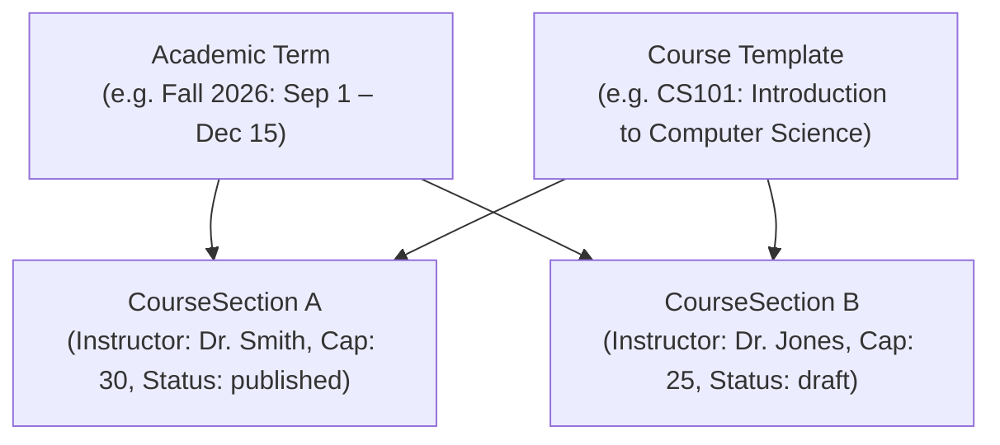

# 8. Courses, Terms & Sections

In this chapter, we will build HTTP endpoints to manage the academic curriculum hierarchy: **Academic Terms**, **Courses**, and **Course Sections**.

---

## The Academic Hierarchy



- **Course:** The master curriculum template ("CS101: Introduction to Computer Science").
- **CourseSection:** A specific scheduled cohort with assigned instructors, a student seat cap, and an operational status.
- **AcademicTerm:** Defines term start and end boundaries for an institution.

---

## Section Status Lifecycle

Sections transition through three states:

```
[draft] ──(publish)──> [published] ──(archive)──> [archived]
```

1. **`draft`**: The course is under construction. Students cannot browse content or enroll unless staff explicitly specify `allowDraft: true`.
2. **`published`**: Active enrollment is open. Students can enroll and view published modules.
3. **`archived`**: The term has ended. The section is read-only; no new enrollments or submissions are permitted.

---

## Implementing Course Routes (`src/routes/courses.ts`)

Create `src/routes/courses.ts`:

```ts
import { Hono } from "hono";
import { eq } from "drizzle-orm";
import { db } from "../db";
import { courses, courseSections, academicTerms } from "../db/schema";
import { requireAuth } from "../lib/middleware";
import { handleDomainError } from "../lib/errors";

export const courseRoutes = new Hono();

// 1. Create an Academic Term
courseRoutes.post("/terms", requireAuth, async (c) => {
  const { name, startsAt, endsAt } = await c.req.json();
  const user = c.get("user");

  if (!user.roles.includes("admin")) {
    return c.json({ error: "Forbidden", message: "Admin role required" }, 403);
  }

  const id = `term-${crypto.randomUUID().slice(0, 8)}`;
  await db.insert(academicTerms).values({
    id,
    name,
    startsAt: new Date(startsAt),
    endsAt: new Date(endsAt),
    orgId: user.orgId ?? null,
  });

  return c.json({ ok: true, term: { id, name, startsAt, endsAt } }, 201);
});

// 2. Create a Course Template
courseRoutes.post("/", requireAuth, async (c) => {
  const { title, description, departmentId } = await c.req.json();
  const user = c.get("user");

  if (!user.roles.includes("admin") && !user.roles.includes("instructor")) {
    return c.json({ error: "Forbidden", message: "Staff role required" }, 403);
  }

  const id = `course-${crypto.randomUUID().slice(0, 8)}`;
  await db.insert(courses).values({
    id,
    title,
    description: description ?? null,
    departmentId: departmentId ?? null,
    orgId: user.orgId ?? null,
    createdAt: new Date(),
  });

  return c.json({ ok: true, course: { id, title, description } }, 201);
});

// 3. Create a Course Section
courseRoutes.post("/:courseId/sections", requireAuth, async (c) => {
  const courseId = c.req.param("courseId");
  const { termId, capacity } = await c.req.json();
  const user = c.get("user");

  if (!user.roles.includes("admin") && !user.roles.includes("instructor")) {
    return c.json({ error: "Forbidden", message: "Staff role required" }, 403);
  }

  // Verify course exists
  const course = await db.query.courses.findFirst({
    where: eq(courses.id, courseId),
  });
  if (!course) {
    return c.json({ error: "NotFound", message: "Course not found" }, 404);
  }

  const id = `sec-${crypto.randomUUID().slice(0, 8)}`;
  await db.insert(courseSections).values({
    id,
    courseId,
    termId: termId ?? null,
    capacity: capacity ? Number(capacity) : null,
    status: "draft", // Sections start in draft mode
    createdAt: new Date(),
  });

  return c.json(
    { ok: true, section: { id, courseId, capacity, status: "draft" } },
    201,
  );
});

// 4. Update Section Status (Publish or Archive)
courseRoutes.patch("/sections/:sectionId/status", requireAuth, async (c) => {
  const sectionId = c.req.param("sectionId");
  const { status } = await c.req.json();
  const user = c.get("user");

  if (!user.roles.includes("admin") && !user.roles.includes("instructor")) {
    return c.json({ error: "Forbidden", message: "Staff role required" }, 403);
  }

  if (!["draft", "published", "archived"].includes(status)) {
    return c.json(
      { error: "Validation", message: "Invalid status value" },
      400,
    );
  }

  await db
    .update(courseSections)
    .set({ status })
    .where(eq(courseSections.id, sectionId));
  return c.json({ ok: true, sectionId, status });
});
```

---

## Next Steps

With course sections available, we will implement registration, waitlists, and drops in [Chapter 9: Enrollment & Waitlists](/tutorial/09-enrollment).
