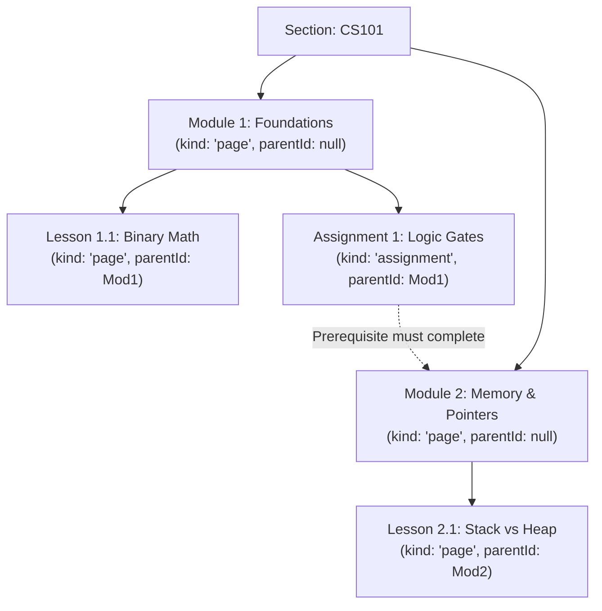

# 10. Course Content

In this chapter, we will build the curriculum authoring engine for Academix using `ContentService`. We will support hierarchical modules, draft/published workflows with automatic version tracking, and sequential prerequisite gating.

---

## The Content Tree Structure

Course content in Discendo is modeled as a tree of `ContentNode` elements:



- **Top-level modules:** Nodes where `parentId === undefined`.
- **Lessons & Assignments:** Child nodes nested beneath a parent module.
- **Node Kinds:** `'page'`, `'assignment'`, `'quiz'`, `'file'`, or `'link'`.

---

## 1. Implementing Content Routes (`src/routes/content.ts`)

Create `src/routes/content.ts`:

```ts
import { Hono } from "hono";
import { contentService } from "../lib/services";
import { requireAuth } from "../lib/middleware";
import { handleDomainError } from "../lib/errors";

export const contentRoutes = new Hono();

// 1. Create a Content Node (Draft)
contentRoutes.post("/sections/:sectionId/nodes", requireAuth, async (c) => {
  const actorId = c.get("actorId");
  const sectionId = c.req.param("sectionId");
  const { title, kind, parentId, orderIndex } = await c.req.json();

  try {
    const node = await contentService.createNode(
      {
        sectionId,
        title,
        kind,
        parentId: parentId ?? undefined,
        orderIndex: orderIndex ?? 0,
        published: false,
      },
      { actorId }, // Requires content.manage permission
    );

    return c.json({ ok: true, node }, 201);
  } catch (err) {
    return handleDomainError(c, err);
  }
});

// 2. Publish a Node (Increments Version)
contentRoutes.post("/nodes/:nodeId/publish", requireAuth, async (c) => {
  const actorId = c.get("actorId");
  const nodeId = c.req.param("nodeId");

  try {
    const node = await contentService.publish(nodeId, { actorId });
    return c.json({ ok: true, node });
  } catch (err) {
    return handleDomainError(c, err);
  }
});

// 3. Unpublish a Node
contentRoutes.post("/nodes/:nodeId/unpublish", requireAuth, async (c) => {
  const actorId = c.get("actorId");
  const nodeId = c.req.param("nodeId");

  try {
    const node = await contentService.unpublish(nodeId, { actorId });
    return c.json({ ok: true, node });
  } catch (err) {
    return handleDomainError(c, err);
  }
});

// 4. Reorder Siblings in a Section
contentRoutes.post("/sections/:sectionId/reorder", requireAuth, async (c) => {
  const actorId = c.get("actorId");
  const sectionId = c.req.param("sectionId");
  const { orderedIds } = await c.req.json(); // Array of string IDs in desired order

  try {
    await contentService.reorder(sectionId, orderedIds, { actorId });
    return c.json({ ok: true, orderedIds });
  } catch (err) {
    return handleDomainError(c, err);
  }
});

// 5. Get a Node (Visibility Controlled)
contentRoutes.get("/nodes/:nodeId", requireAuth, async (c) => {
  const actorId = c.get("actorId");
  const nodeId = c.req.param("nodeId");

  try {
    const node = await contentService.getNode(nodeId, { actorId });
    if (!node) {
      return c.json({ error: "NotFound", message: "Node not found" }, 404);
    }

    // Check if prerequisite is unlocked for students
    const unlocked = await contentService.isUnlocked(nodeId, actorId);

    return c.json({ ok: true, node, unlocked });
  } catch (err) {
    return handleDomainError(c, err);
  }
});
```

---

## 2. Publishing Versions & Visibility

- **Version Bumping:** Calling `/nodes/:nodeId/publish` automatically increments `node.version` and sets `published: true`. The SDK emits `content.published` with the new version number.
- **Fail-Closed Visibility:** Students calling `GET /nodes/:id` on a draft node receive a `PermissionDeniedError` (`403 Forbidden`) rather than a `404`, keeping drafts private without leaking existence. Instructors and TAs can view both draft and published nodes.

---

## 3. Prerequisite Gating

To enforce that students complete Module 1 before accessing Module 2:

1. Configure `CompletionChecker` in `src/lib/services.ts` against your completions table.
2. Define prerequisite dependency edges:
   ```ts
   const prerequisites: PrerequisiteEdge[] = [
     { sourceId: "asg-lab1", targetId: "mod-2" }, // Must complete Lab 1 before Mod 2 unlocks
   ];
   ```
3. When calling `contentService.isUnlocked('mod-2', studentId)`, the service evaluates if all source nodes have been satisfied.

---

## Next Steps

Now that course materials and assignments exist in our content tree, we will implement student turn-ins and randomized quizzes in [Chapter 11: Assignments & Quizzes](/tutorial/11-assessment).
