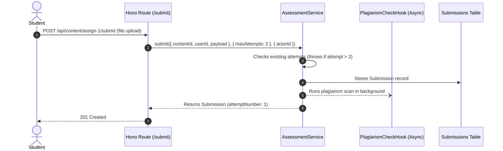

# 11. Assignments & Quizzes

In this chapter, we will build the assessment engine for Academix using `AssessmentService`. It handles file and text submissions, enforces maximum attempt limits, randomizes quiz questions per student, and evaluates multi-criteria rubrics.

---

## 1. Assignment Submissions

Students turn in work against content nodes of `kind: 'assignment'`:



### Implementing Submission Endpoints (`src/routes/submissions.ts`)

```ts
import { Hono } from "hono";
import { assessmentService } from "../lib/services";
import { requireAuth } from "../lib/middleware";
import { handleDomainError } from "../lib/errors";

export const submissionRoutes = new Hono();

// Student submits assignment
submissionRoutes.post("/content/:contentId/submit", requireAuth, async (c) => {
  const actorId = c.get("actorId");
  const contentId = c.req.param("contentId");
  const { kind, content, maxAttempts } = await c.req.json();

  try {
    const submission = await assessmentService.submit(
      {
        contentId,
        userId: actorId,
        payload: {
          kind: kind as "text" | "file" | "url",
          ...(kind === "file" ? { ref: content } : {}),
          ...(kind === "text" ? { content } : {}),
          ...(kind === "url" ? { href: content } : {}),
        } as any,
      },
      { maxAttempts: maxAttempts ?? 3 },
      { actorId }, // Requires assessment.submit permission
    );

    return c.json({ ok: true, submission }, 201);
  } catch (err) {
    return handleDomainError(c, err);
  }
});
```

---

## 2. Interactive Randomized Quizzes

Quizzes protect academic integrity by **randomizing the question sequence** for each student attempt and calculating objective scores automatically upon submission.

### Quiz Workflow Endpoints (`src/routes/quizzes.ts`)

```ts
import { Hono } from "hono";
import { assessmentService } from "../lib/services";
import { requireAuth } from "../lib/middleware";
import { handleDomainError } from "../lib/errors";

export const quizRoutes = new Hono();

// 1. Start a Quiz Attempt (Questions Shuffled)
quizRoutes.post("/quizzes/:quizId/attempts", requireAuth, async (c) => {
  const actorId = c.get("actorId");
  const quizId = c.req.param("quizId");

  try {
    const attempt = await assessmentService.startQuizAttempt(quizId, actorId, {
      actorId,
    });
    return c.json(
      {
        ok: true,
        attemptId: attempt.id,
        startedAt: attempt.startedAt,
        // Returns question list without answer keys
        questions: attempt.questions,
      },
      201,
    );
  } catch (err) {
    return handleDomainError(c, err);
  }
});

// 2. Save Answer to a Question Progressively
quizRoutes.put("/attempts/:attemptId/answers", requireAuth, async (c) => {
  const actorId = c.get("actorId");
  const attemptId = c.req.param("attemptId");
  const { questionId, choiceIndex } = await c.req.json();

  try {
    await assessmentService.saveQuizAnswer(attemptId, questionId, choiceIndex, {
      actorId,
    });
    return c.json({ ok: true, questionId, choiceIndex });
  } catch (err) {
    return handleDomainError(c, err);
  }
});

// 3. Submit Completed Quiz Attempt (Auto-Scored)
quizRoutes.post("/attempts/:attemptId/submit", requireAuth, async (c) => {
  const actorId = c.get("actorId");
  const attemptId = c.req.param("attemptId");

  try {
    const result = await assessmentService.submitQuiz(attemptId, { actorId });
    return c.json({
      ok: true,
      score: result.score,
      maxScore: result.maxScore,
      percentage: (result.score / result.maxScore) * 100,
      submittedAt: result.submittedAt,
    });
  } catch (err) {
    return handleDomainError(c, err);
  }
});
```

::: tip Automated Gradebook Integration
When configured with `autoGrade: gradingService`, submitting a quiz automatically records the resulting score into the student's gradebook under `graderId: 'system:quiz'`, without manual instructor intervention.
:::

---

## 3. Rubric Evaluations (`RubricService`)

Instructors evaluate qualitative submissions (such as research papers or essays) against multi-criteria rubrics:

```ts
import { RubricService } from "discendo-sdk/assessment";

const rubricService = new RubricService(rubricRepo, { policy });

// Evaluate an essay against thesis, evidence, and structure criteria
const evaluation = await rubricService.evaluateSubmission(
  {
    contentId: "asg-essay-1",
    submissionId: "sub-101",
    scores: {
      "crit-thesis": 10, // max 10
      "crit-evidence": 18, // max 20
      "crit-structure": 9, // max 10
    },
    feedback: "Strong argument, excellent citations.",
  },
  { actorId: "u-instructor" },
);

console.log(`Rubric Total: ${evaluation.totalScore} / ${evaluation.maxScore}`); // 37 / 40
```

---

## Next Steps

Now that submissions and quiz attempts are recorded, we will build the gradebook, weighted category schemes, and late penalty calculations in [Chapter 12: Grading & Gradebook](/tutorial/12-grading).
