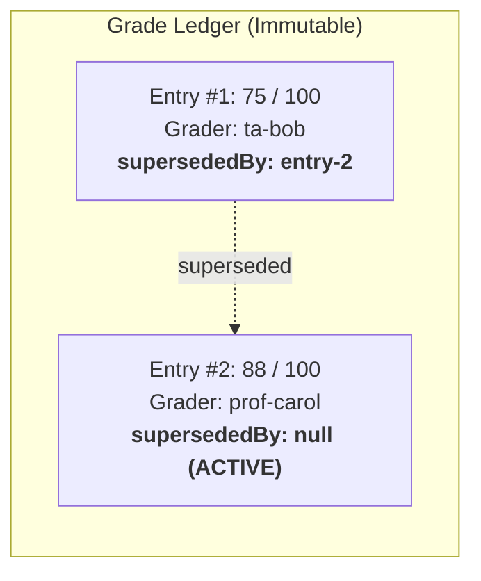

# 12. Grading & Gradebook

In this chapter, we will build the gradebook engine for Academix using `GradingService` and its pure calculation functions. We will implement immutable grade entries with complete regrade trails, weighted category schemes, late submission penalties, and letter grade conversions.

---

## The Immutable Grade Ledger

In educational applications, updating a grade must never overwrite the original record. When an instructor regrades an assignment, Discendo inserts a **new** `GradeEntry` and points the previous entry's `supersededBy` field to the new record:



Only active, non-superseded entries are included in final grade calculations.

---

## 1. Grade Repository (`src/db/repositories/grades.ts`)

Create `src/db/repositories/grades.ts` to implement `GradeRepository`:

```ts
import { eq, and, isNull } from "drizzle-orm";
import type { GradeRepository, GradeEntry } from "discendo-sdk/grading";
import { db } from "../index";
import { gradeEntries } from "../schema";

export class DrizzleGradeRepository implements GradeRepository {
  async create(entry: Omit<GradeEntry, "id">): Promise<GradeEntry> {
    const id = crypto.randomUUID();
    await db.insert(gradeEntries).values({
      id,
      submissionId: entry.submissionId,
      userId: entry.userId,
      score: entry.score,
      maxScore: entry.maxScore,
      graderId: entry.graderId,
      gradedAt: entry.gradedAt,
      supersededBy: null,
    });
    return { id, ...entry };
  }

  async findById(id: string): Promise<GradeEntry | null> {
    const row = await db.query.gradeEntries.findFirst({
      where: eq(gradeEntries.id, id),
    });
    if (!row) return null;
    return {
      id: row.id,
      submissionId: row.submissionId,
      userId: row.userId,
      score: row.score,
      maxScore: row.maxScore,
      graderId: row.graderId,
      gradedAt: row.gradedAt,
      ...(row.supersededBy ? { supersededBy: row.supersededBy } : {}),
    };
  }

  async markSuperseded(id: string, byId: string): Promise<void> {
    await db
      .update(gradeEntries)
      .set({ supersededBy: byId })
      .where(eq(gradeEntries.id, id));
  }

  // Returns ONLY active, non-superseded entries for a student
  async listActiveForUser(userId: string): Promise<GradeEntry[]> {
    const rows = await db.query.gradeEntries.findMany({
      where: and(
        eq(gradeEntries.userId, userId),
        isNull(gradeEntries.supersededBy),
      ),
    });
    return rows.map((row) => ({
      id: row.id,
      submissionId: row.submissionId,
      userId: row.userId,
      score: row.score,
      maxScore: row.maxScore,
      graderId: row.graderId,
      gradedAt: row.gradedAt,
    }));
  }
}
```

---

## 2. Implementing Grading Routes (`src/routes/grades.ts`)

Create `src/routes/grades.ts`:

```ts
import { Hono } from "hono";
import { gradingService } from "../lib/services";
import {
  computeFinalGrade,
  applyLatePolicy,
  toLetterGrade,
} from "discendo-sdk/grading";
import { requireAuth } from "../lib/middleware";
import { handleDomainError } from "../lib/errors";

export const gradeRoutes = new Hono();

// 1. Record a Grade (or Regrade)
gradeRoutes.post("/submissions/:submissionId/grade", requireAuth, async (c) => {
  const actorId = c.get("actorId");
  const submissionId = c.req.param("submissionId");
  const { userId, score, maxScore, previousEntryId } = await c.req.json();

  try {
    const entry = await gradingService.recordGrade(
      submissionId,
      userId,
      Number(score),
      Number(maxScore),
      actorId, // Recorded grader
      previousEntryId ?? undefined, // If provided, supersedes the old entry
      { actorId }, // Requires grading.record permission
    );

    return c.json({ ok: true, entry }, 201);
  } catch (err) {
    return handleDomainError(c, err);
  }
});

// 2. Student Views Their Final Course Grade
gradeRoutes.get("/sections/:sectionId/grades/me", requireAuth, async (c) => {
  const actorId = c.get("actorId");
  const sectionId = c.req.param("sectionId");

  try {
    // 1. Fetch active grades for student
    const entries = await (gradingService as any).grades.listActiveForUser(
      actorId,
    );

    // 2. Define the section's weighted grading scheme
    const scheme = {
      categories: [
        { name: "homework", weight: 0.4, dropLowestN: 1 }, // 40% weight, drop lowest score
        { name: "exams", weight: 0.6 }, // 60% weight
      ],
    };

    // 3. Compute final percentage using pure function
    const categorizedEntries = new Map([
      ["homework", entries.filter((e: any) => e.category === "homework")],
      ["exams", entries.filter((e: any) => e.category === "exams")],
    ]);

    const finalPercent = computeFinalGrade(categorizedEntries, scheme);

    // 4. Convert percentage to letter grade
    const letter = toLetterGrade(finalPercent, [
      { minPercent: 90, label: "A" },
      { minPercent: 80, label: "B" },
      { minPercent: 70, label: "C" },
      { minPercent: 60, label: "D" },
      { minPercent: 0, label: "F" },
    ]);

    return c.json({
      ok: true,
      entries,
      finalGrade: {
        percentage: Number(finalPercent.toFixed(2)),
        letter,
      },
    });
  } catch (err) {
    return handleDomainError(c, err);
  }
});
```

---

## 3. Late Submission Penalties

When scoring late submissions, apply deductions using `applyLatePolicy`:

```ts
import { applyLatePolicy } from "discendo-sdk/grading";

// 100 points, submitted 3 days late with a 5% per day deduction (capped at 20%)
const rawScore = 85;
const maxScore = 100;
const daysLate = 3;

const adjustedScore = applyLatePolicy(rawScore, maxScore, daysLate, {
  kind: "flatPenalty",
  percentPerDay: 5,
  maxPenaltyPercent: 20,
});

console.log(`Adjusted Score: ${adjustedScore} / 100`); // 70 / 100
```

---

## Next Steps

Now we enter **Phase 4: Operations & Shipping**, starting with timetables in [Chapter 13: Timetables](/tutorial/13-timetables).
