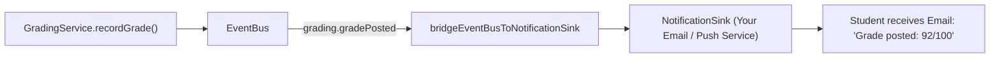

# 14. Announcements & Notifications

In this chapter, we will build section communication channels using `CommunicationService`, enforce strict audience separation between students and parents, and route SDK domain events into an email/push notification dispatcher.

---

## 1. Implementing Communication Routes (`src/routes/communication.ts`)

Create `src/routes/communication.ts`:

```ts
import { Hono } from "hono";
import { commsService } from "../lib/services";
import { requireAuth } from "../lib/middleware";
import { handleDomainError } from "../lib/errors";

export const commsRoutes = new Hono();

// 1. Post a Section Announcement
commsRoutes.post(
  "/sections/:sectionId/announcements",
  requireAuth,
  async (c) => {
    const actorId = c.get("actorId");
    const sectionId = c.req.param("sectionId");
    const { title, body, audience } = await c.req.json();

    try {
      const announcement = await commsService.postAnnouncement(
        {
          sectionId,
          title,
          body,
          audience: (audience as "students" | "guardians") || "students",
        },
        { actorId }, // Requires communication.postAnnouncement or postGuardianAnnouncement
      );

      return c.json({ ok: true, announcement }, 201);
    } catch (err) {
      return handleDomainError(c, err);
    }
  },
);

// 2. View Announcements (Audience Segregated)
commsRoutes.get(
  "/sections/:sectionId/announcements",
  requireAuth,
  async (c) => {
    const actorId = c.get("actorId");
    const sectionId = c.req.param("sectionId");

    try {
      const list = await commsService.listAnnouncements(sectionId, { actorId });
      return c.json({ ok: true, announcements: list });
    } catch (err) {
      return handleDomainError(c, err);
    }
  },
);

// 3. Create Discussion Thread
commsRoutes.post("/sections/:sectionId/threads", requireAuth, async (c) => {
  const actorId = c.get("actorId");
  const sectionId = c.req.param("sectionId");
  const { title, contentId, firstPost } = await c.req.json();

  try {
    const thread = await commsService.createThread(
      {
        sectionId,
        title,
        contentId: contentId ?? undefined,
        firstPost: { authorId: actorId, body: firstPost },
      },
      { actorId },
    );

    return c.json({ ok: true, thread }, 201);
  } catch (err) {
    return handleDomainError(c, err);
  }
});

// 4. Reply to Discussion Thread
commsRoutes.post("/threads/:threadId/reply", requireAuth, async (c) => {
  const actorId = c.get("actorId");
  const threadId = c.req.param("threadId");
  const { body } = await c.req.json();

  try {
    const post = await commsService.reply(
      threadId,
      { authorId: actorId, body },
      { actorId },
    );

    return c.json({ ok: true, post }, 201);
  } catch (err) {
    return handleDomainError(c, err);
  }
});
```

---

## 2. Bridging Domain Events to Email / Push Notifications

The SDK includes `bridgeEventBusToNotificationSink` to automatically turn SDK events into notification dispatches:



Configure the bridge in `src/lib/services.ts`:

```ts
import { bridgeEventBusToNotificationSink } from "discendo-sdk/communication";
import type { NotificationSink } from "discendo-sdk/communication";

// 1. Implement your notification delivery sink
const emailNotificationSink: NotificationSink = {
  dispatch: async (event) => {
    if (event.type === "gradePosted") {
      const user = await repos.users.findById(event.userId);
      console.log(
        `[Email Mock] Sending grade update to ${user?.id}: Score ${event.score}`,
      );
    } else if (event.type === "announcementCreated") {
      console.log(
        `[Push Mock] Broadcasting announcement "${event.title}" to section ${event.sectionId} (audience: ${event.audience})`,
      );
    }
  },
};

// 2. Connect the bridge
bridgeEventBusToNotificationSink(bus, emailNotificationSink, {
  resolveContentId: async (submissionId) => {
    // Resolve contentId from submission if needed
    return null;
  },
});
```

Because events are fire-and-forget, notification delivery never delays the HTTP response of an instructor posting a grade or announcement.

---

## Next Steps

Next, we will track student attendance roll calls and export reports in [Chapter 15: Attendance & Reports](/tutorial/15-reports).
