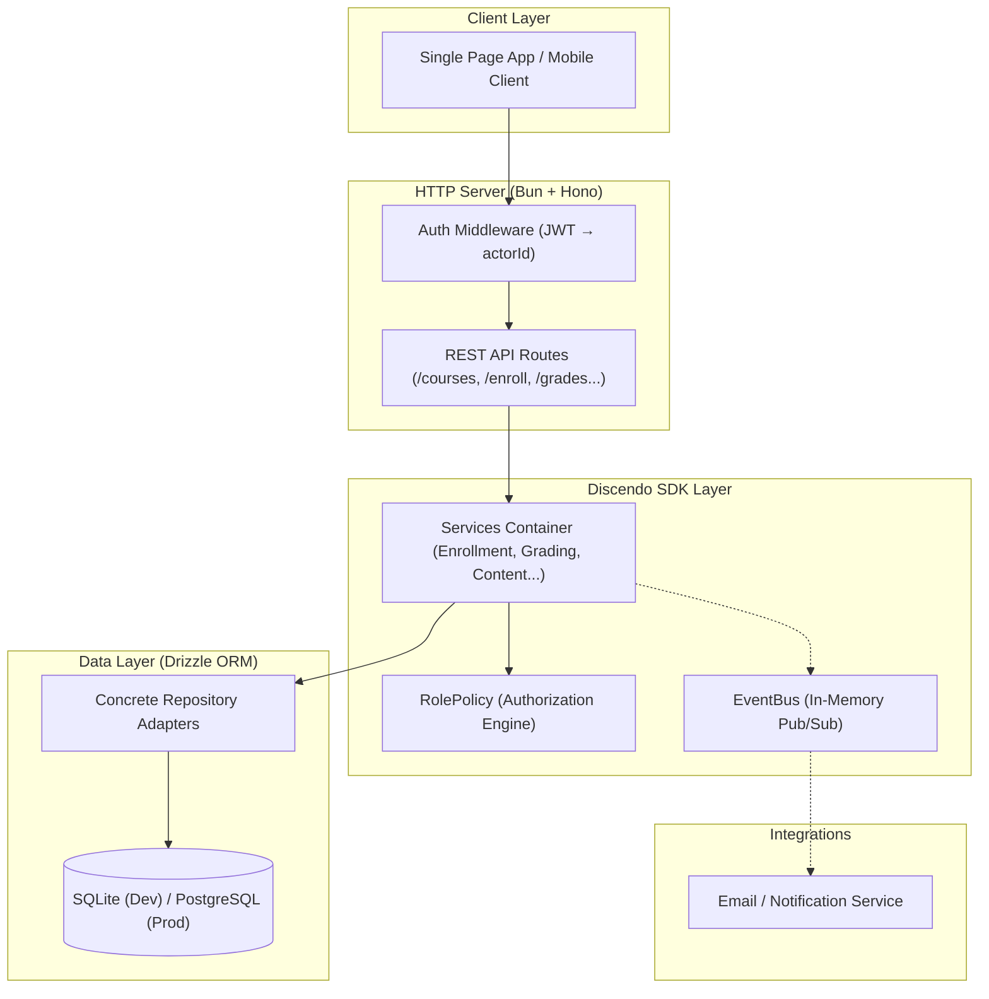

# Build an LMS with Discendo SDK

In this hands-on tutorial, you will build a complete, production-ready backend for a modern Learning Management System called **Academix**.

Unlike generic tutorials that use toys or in-memory arrays, this guide builds a real web application with a relational database, transactional repository adapters, JWT authentication, role-based access control, and asynchronous notification delivery.

---

## What We Are Building

By the end of this guide, your application will handle:

- **Authentication & Multi-Tenancy:** Secure authentication mapped to verified SDK `Identity` records, with hard organizational walls for multi-tenant deployments.
- **Course Rosters & Registration:** Publishing courses, enforcing section seat caps, atomic waitlist queues, auto-promotion on drop, and SIS bulk imports.
- **Curriculum & Content Trees:** Hierarchical modules, pages, and assignments with publishing versions and prerequisite unlocking.
- **Assessments & Quizzes:** Student file submissions, randomized quiz attempts with progressive saving, and objective auto-scoring.
- **Gradebook & Calculations:** Weighted grade categories, drop-lowest rules, late submission penalties, grade overrides with immutable audit trails, and GPA calculations.
- **Timetables & Rooms:** Recurring class session schedules, calendar materialization, classroom capacity checks, and automated backtracking timetable solving.
- **Announcements & Reports:** Discussion threads, guardian portals, attendance roll calls, and CSV exports.

---

## The Tech Stack

We chose a lightweight, modern TypeScript stack that matches Discendo's high-performance, dependency-free philosophy:

| Layer                   | Technology                                  | Why We Use It                                                                                                                        |
| ----------------------- | ------------------------------------------- | ------------------------------------------------------------------------------------------------------------------------------------ |
| **Runtime**             | [**Bun**](https://bun.sh)                   | Blazing-fast execution, native TypeScript support, built-in test runner, zero build step needed during development.                  |
| **HTTP Framework**      | [**Hono**](https://hono.dev)                | Extremely fast, lightweight, and type-safe web framework with intuitive middleware and OpenAPI compatibility.                        |
| **ORM / Query Builder** | [**Drizzle ORM**](https://orm.drizzle.team) | Schema-first, lightweight, type-safe SQL query builder with zero runtime bloat.                                                      |
| **Database**            | **SQLite (dev) / PostgreSQL (prod)**        | File-based SQLite (`bun:sqlite`) for zero-configuration local development; drop-in compatible with PostgreSQL for cloud deployments. |
| **LMS Business Logic**  | **Discendo SDK**                            | Replaces thousands of lines of fragile custom business logic with tested, hardened academic workflows.                               |

---

## Roadmap

The tutorial is structured into four progressive phases:

### Phase 1: Foundation (Chapters 1–4)

- **[1. Project Setup](/tutorial/01-project-setup):** Bootstrapping the project, configuring dependencies, and establishing folder structure.
- **[2. Database Schema](/tutorial/02-database-schema):** Designing relational tables with Drizzle ORM to back the SDK domain entities.
- **[3. Implementing Repositories](/tutorial/03-repositories):** Building robust, transactional repository adapters matching `RepositoryContext`.
- **[4. Wiring Services](/tutorial/04-wiring-services):** Assembling the global service container with EventBus and PermissionPolicy.

### Phase 2: People & Access (Chapters 5–7)

- **[5. Authentication & Actors](/tutorial/05-authentication):** Building JWT authentication middleware and resolving authenticated users into SDK actors.
- **[6. Roles & Permissions](/tutorial/06-permissions):** Protecting API routes with fail-closed permissions and customizing role policies.
- **[7. Organizations & Departments](/tutorial/07-organizations):** Implementing multi-tenant boundaries and departmental groupings.

### Phase 3: Teaching & Learning (Chapters 8–12)

- **[8. Courses, Terms & Sections](/tutorial/08-courses):** Creating courses, academic calendars, and configuring cohorts.
- **[9. Enrollment & Waitlists](/tutorial/09-enrollment):** Implementing course registration APIs, atomic seat locking, and waitlist promotion.
- **[10. Course Content](/tutorial/10-content):** Building content tree hierarchies, publishing version workflows, and prerequisite gating.
- **[11. Assignments & Quizzes](/tutorial/11-assessment):** Managing file uploads, randomized quizzes, scoring rubrics, and plagiarism seams.
- **[12. Grading & Gradebook](/tutorial/12-grading):** Recording grades with immutable regrade trails, weighted categories, late penalties, and GPA.

### Phase 4: Operations & Shipping (Chapters 13–19)

- **[13. Timetables](/tutorial/13-timetables):** Setting up class schedules, conflict detection, and using the auto-scheduling solver.
- **[14. Announcements & Notifications](/tutorial/14-notifications):** Broadcasting student announcements and bridging domain events to email/push notifications.
- **[15. Attendance & Reports](/tutorial/15-reports):** Taking attendance roll calls and generating downloadable CSV reports.
- **[16. Audit Log](/tutorial/16-audit-log):** Capturing compliance audit trails using `withAudit` and `AdminService`.
- **[17. Parent Portal (Guardians)](/tutorial/17-guardians):** Establishing read-only guardian links for student academic oversight.
- **[18. Testing](/tutorial/18-testing):** Writing integration tests with Bun's native test runner.
- **[19. Deployment](/tutorial/19-deployment):** Production deployment with Docker and PostgreSQL.

---

Ready? Let's start with [Chapter 1: Project Setup](/tutorial/01-project-setup).
